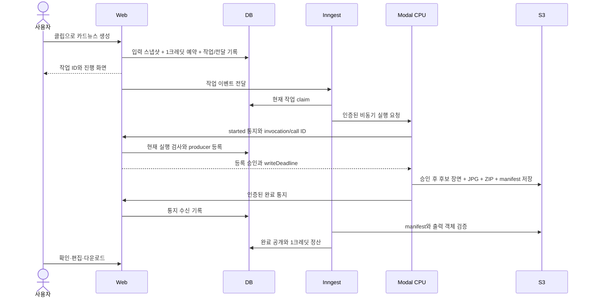

# 완성된 숏폼 기반 Instagram 카드뉴스 생성 제안서

## Summary

사용자가 선택한 완성된 숏폼 1개를 Instagram에 게시할 수 있는 카드뉴스 1세트로 확장한다. 영상의 대본을 읽기 좋은 원고로 재구성하고, 실제 영상 장면을 사용하는 표지와 텍스트 중심 본문을 렌더링한다. 카드뉴스 생성 및 사용자가 요청한 AI 재생성은 각각 1크레딧이며, 수동 편집과 재다운로드는 무료다.

기존 영상과 카드뉴스가 같은 잔액을 사용하므로 **공통 크레딧 예약·정산 기반을 먼저 구현**한다. 원고 생성과 이미지 렌더링은 기존 GPU 영상 파이프라인과 분리한 CPU 작업으로 수행한다. 첫 출시 결과물은 순서가 정해진 JPG, ZIP, Instagram 게시글·해시태그다.

이 문서는 구현 근거와 검증 조건을 기록한다. 후속 사용자의 명시적 요청으로 제품 코드를 구현했고, 분리된 로컬 검증을 진행했다. 운영 DB migration·배포·유료 외부 생성은 수행하지 않았다. 실제 변경과 남은 출시 검증은 끝의 Implementation Results 및 [운영 실행 문서](../../card-news-runbook.md)에 기록한다.

## Goal

### US-CN-01: 영상 내용을 다른 게시 형식으로 재사용한다

사용자는 이미 만든 숏폼의 핵심 내용을 영상 시청 없이 이해하고 저장할 수 있는 카드뉴스로 만들고, 필요한 문구를 다듬어 Instagram에 게시할 파일을 받고 싶다.

### 합의된 제품 결정

| 항목 | 결정 | 근거 |
| --- | --- | --- |
| 목적 | 핵심 내용 이해·저장용 독립 게시물 | 사용자 선택 |
| 입력 단위 | 완성된 숏폼 1개 → 카드뉴스 1세트 | 사용자 선택 |
| 디자인 | 텍스트 중심 본문 + 표지에 영상 장면 | 사용자 선택 |
| 편집 범위 | 문구·카드 순서·색상·표지 수정 | 사용자 선택 |
| 기본 가격 | 카드뉴스 1세트당 1크레딧 | 사용자 선택 |
| AI 재생성 | 요청할 때마다 추가 1크레딧 | 사용자 선택 |
| 수동 수정 | 추가 차감 없이 제공 | 사용자 선택 |
| 전달 방식 | 이미지 다운로드 + 게시글·해시태그 복사 | 사용자 선택 |

이하의 장수·레이아웃·모델·작업 제한·데이터 구조·보관 정책은 위 결정을 구현하기 위한 **제안**이다. 이번 대조 검증은 기존 제안의 의도를 유지하며 구현 누락을 보완한다. 제안값을 사용자 확정 정책으로 승격하지 않는다.

## Proposal Size / 근거 기준

- `proposal-size`: `standard`.
- SDD 위험도: **HIGH-RISK**. 공유 크레딧의 동시 소비, 데이터 마이그레이션, 비동기 작업의 복구, 삭제와 생성의 경쟁이 포함된다.
- 조사 기준: `dev`, commit `b20722b194f4a5014423e7790dfa188cb9cca367`, 최초 작성 2026-10-10, 코드 대조 재검증 2026-10-11.
- 조사 시작 시 작업 트리: 추적 파일 변경 없음, 기존 미추적 `nul` 존재. 이 파일은 변경·삭제·스테이징하지 않는다.
- 저장소와 상위 경로 조사에서 적용할 `AGENTS.md`는 발견하지 않았다. 루트·web·backend의 `CLAUDE.md`, proposal 템플릿, FSD 규약을 참고했다.
- **Observed**는 직접 읽은 코드, **Contracted**는 사용자 결정 또는 명시된 저장소 규약, **Inferred**는 코드에서 도출한 결론, **Proposed**는 새 설계를 뜻한다.
- 아래 Current State·코드 대조 표는 구현 전 commit의 조사 기록이다. 경로 표의 `신규`는 구현 당시 추가 대상이며, 구현 후 상태와 실행 증거는 끝의 Implementation Results를 기준으로 한다.

## Current State

| 관심사 | 현재 코드에서 관측한 사실 | 구현 영향 |
| --- | --- | --- |
| 클립 입력 | [Clip 모델](../../../packages/db/prisma/schema.prisma)의 `scriptText`, `startSeconds`, `endSeconds`, `hook`, `payoff`, `clipType`, `subtitleStatus`가 nullable로 존재한다 | 새 전사 없이 대본 재사용 가능. 오래된 데이터의 누락은 생성 전 검사한다 |
| 원본 접근 | `Clip.uploadedFile`을 통해 `UploadedFile.s3Key`와 설정 언어에 접근할 수 있다 | 자막이 입혀진 완성 MP4 대신 업로드 원본의 해당 구간에서 표지를 추출한다 |
| 전사 보존 | `apps/backend/main.py::_do_process_video`는 `mode == "analyze"`에서 전사 JSON을 S3에 저장한다 | 모든 클립에 `transcriptS3Key`가 있다고 가정하지 않는다 |
| 대본 언어 | `process_clip`은 선택 언어의 자막 대본을 `scriptText`로 반환한다. 한국어 번역은 일부/전체 영어 폴백이 가능하다 | 기본 목표 언어는 업로드 설정을 따른다. 폴백 상태를 숨기지 않으며 카드 원고 생성에서 해당 언어로 작성한다 |
| 기존 과금 | [completeUploadedFileProcessingAttempt](../../../apps/web/src/fsd/features/upload/api/complete-processing-attempt.ts)는 상태 전이와 생성 클립 수만큼의 차감을 한 DB 트랜잭션으로 수행한다 | 부분 성공 영상의 실제 생성분 과금과 중복 완료 방지는 보존한다 |
| 잔액 보호 | `User.credits`는 정수이며 `decrementUserCreditsFloorZero`는 `GREATEST(credits - amount, 0)`을 사용한다 | 잔액을 0 아래로 내리지 않는 것만으로 동시 과다 소비를 막을 수 없다 |
| 영상 동시성 | `startUploadedFileProcessingAttempt`와 DB 부분 유니크 인덱스가 사용자당 영상 processing 1건을 보장한다 | 다른 종류의 카드뉴스 작업과의 잔액 경쟁은 이 인덱스로 보호되지 않는다 |
| 작업 전달 | `ProcessingDispatch`와 `dispatch-processing.ts`가 영상 전달 상태를 저장한다. GPU endpoint는 accepted와 `call_id`를 반환하지만 현재 worker는 ID를 저장하지 않는다 | 이벤트 전달 상태와 실제 Modal spawn 상태를 구분하고, 기존 응답 ID를 지속 저장한다 |
| 실행 시간 | `app/api/inngest/route.ts`의 `maxDuration`은 10초다. 현재 Modal 호출은 비동기 spawn + callback 방식이다 | 원고·이미지 생성 전체를 Next.js 요청 하나에서 기다리지 않는다 |
| 화면 | `widgets/clip-display/ui/_component/ClipCard.tsx`, `ClipActions.tsx`에 영상 다운로드·대본·YouTube 메타데이터 행동이 있다 | 카드뉴스 진입 행동을 추가하고 상세 편집은 별도 페이지에 둔다 |
| 삭제 | `deleteClip`은 MP4와 Clip을 삭제하고, `deleteUploadedFile`은 활성 영상 작업을 막은 뒤 원본 prefix 자산과 DB를 삭제한다 | 파생 카드뉴스와 활성 CPU 작업도 삭제 정책에 포함해야 한다 |
| 분석 계약 | `packages/db/src/analytics-contract.ts`가 web/admin 공통 이벤트 정본이다 | 이벤트명·메타데이터를 web에만 추가하지 않는다 |
| 의존성 | web은 npm·Next.js·Zod·TanStack Query·Inngest, backend는 Modal·google-genai·FFmpeg를 사용한다. CPU 카드 렌더 전용 환경은 없다 | 전용 환경과 이미지 렌더 의존성의 실제 검증은 구현 단계에서 수행한다 |

## Scope

포함 범위:

- 소유한 완성 클립의 대본·구간 검증과 원고 생성.
- 표지·본문·요약 템플릿, 표지 후보 장면, JPG·ZIP 렌더링.
- 공통 크레딧 예약과 영상·카드뉴스 정산 및 실패 복구.
- 카드뉴스 목록, 생성 상태, 편집, AI 재생성, 다운로드·복사.
- 원본/클립 삭제와 파생 결과물 정리, 최소 계측과 출시 문구 갱신.

제외 범위:

- 여러 숏폼 병합, 원본 영상 전체 요약, 카드뉴스 전용 영상 업로드.
- AI 이미지 생성, 모든 본문 카드에 영상 배경 적용, 자유 요소 배치 편집기.
- Instagram 계정 연결, 직접 게시, 예약 게시, 게시 성과 자동 수집.
- 새 구독 상품, 크레딧 단가 변경, 기존 결제 webhook의 별도 리팩터링.

## Behavioral Requirements

### REQ-CN-001: 생성 가능 입력을 검사한다

WHEN 사용자가 카드뉴스 생성을 요청하면, 시스템은 인증된 사용자 소유의 완성 Clip, 비어 있지 않은 대본, 유효한 원본 구간과 원본 파일을 검사하고, 조건을 충족하지 못하면 비용 발생 작업과 크레딧 예약 없이 생성 불가 사유를 반환해야 한다.

원본 구간은 유한한 수이며 `0 <= startSeconds < endSeconds`여야 한다. `hook`·`payoff` 누락은 차단 사유가 아니다. 원본 파일의 HEAD 조회가 실패하면 없음으로 단정하지 않고 일시 오류로 안내한다.

완성 입력의 판정은 Clip 행 존재, Clip/UploadedFile 동일 소유자, 확인된 원본 업로드, `0 < Clip.processingAttempt <= UploadedFile.lastSuccessfulAttempt`, Clip MP4와 원본의 HEAD 성공, 삭제 의도 없음이다. 과거 성공 시도의 보존된 Clip도 이 판정을 사용하며 현재 영상 시도의 상태만으로 완성을 추정하지 않는다. HEAD는 트랜잭션 밖에서 수행하고 예약 직전 잠금 안에서 DB 식별자·구간·대본·삭제 상태를 재검사한다. CPU에서도 실제 영상 길이 안의 구간인지 검사한다.

### REQ-CN-002: 원문에 근거한 독립 원고를 만든다

WHEN AI 원고를 생성하면, 시스템은 원문에 근거한 3~7장 구성, 카드별 하나의 메시지, 표지와 마지막 요약, 게시글과 해시태그를 반환해야 하며, 원문에 없는 수치·인물·사례를 새로운 사실로 추가하지 않아야 한다.

원문이 3장을 반복 없이 채울 수 없으면 `insufficient_content`로 실패시킨다. AI 작성 카드에는 대본의 근거 문장 인덱스를 저장한다. 이 규칙의 의미 정확성은 자동 구조 검사만으로 입증할 수 없으므로 별도의 원문 대조 평가를 수행한다.

### REQ-CN-003: 읽기 가능한 템플릿 이미지로 완성한다

WHEN 카드 이미지를 렌더링하면, 시스템은 실제 영상 장면을 사용하는 표지와 텍스트 중심 본문을 동일한 1080×1350 RGB JPEG 규격으로 출력하고, 글자 누락·영역 넘침·카드 누락을 성공 결과로 공개하지 않아야 한다.

이 규격은 제품 기본안이며 Instagram 전체 허용 규격이나 장수 상한에 관한 주장이 아니다.

### REQ-CN-004: 수동 편집과 무료 재렌더를 제공한다

WHEN 사용자가 문구·순서·테마 색상·표지 후보 또는 게시글·해시태그를 수정하면, 시스템은 크레딧 차감과 AI 호출 없이 편집본을 저장하고 해당 버전의 파일을 다시 렌더링해야 한다.

같은 버전 요청은 기존 작업/결과를 재사용한다. 다른 탭의 오래된 편집은 충돌로 반환한다. 사용자 수정 문구는 `user-edited`로 표시하고 원문 기반 AI 검증을 거친 내용으로 오인하지 않게 한다.

최초 유료 결과가 ready가 된 뒤 편집을 허용한다. 실패한 무료 렌더는 새 실행 작업으로 재시도할 수 있고, 기존 실패 이력이나 종결 예약을 held로 되돌리지 않는다. 저장 전 구조·색상·표지 ID·문구 길이를 검사하며 실제 폰트 overflow는 렌더 오류로 필드별 안내한다.

### REQ-CN-005: 출력 버전과 순서를 보장한다

WHEN 사용자가 결과를 내보내면, 시스템은 선택한 완성 버전의 `01-cover.jpg`부터 이어지는 이미지, 같은 순서의 ZIP, 해당 버전의 게시글·해시태그를 제공해야 한다.

최신 편집본 렌더가 아직 끝나지 않았다면 최신 버전 다운로드를 비활성화하고 진행 상태를 표시한다. 이전 완성 버전은 버전 번호를 표시해 따로 내려받을 수 있다. URL 만료는 무료로 재발급한다.

### REQ-CN-006: 최초 생성은 세트당 1크레딧을 사용한다

WHEN 유효한 최초 생성 요청이 수락되면, 시스템은 1크레딧을 예약하고, 전체 이미지·ZIP·게시글·해시태그가 검증·저장되어 열람 가능한 경우에만 1크레딧 사용을 확정해야 한다.

생성 전 버튼에 비용과 사용 가능 잔액을 표시한다. 다운로드 여부는 과금 조건이 아니다. 이미 소비한 숏폼 크레딧을 다시 차감하지 않는다.

### REQ-CN-007: AI 재생성은 새 유료 결과를 만든다

WHEN 사용자가 AI 재생성을 요청하면, 시스템은 추가 1크레딧 비용을 표시하고 새 세트를 생성해야 하며, 이전 세트와 수동 편집본을 덮어쓰지 않아야 한다.

AI 입력은 최초의 영상 대본 스냅샷이다. 사용자가 편집한 카드 문구를 원본 사실로 취급하지 않는다. 새 결과 실패 시 이전 결과는 계속 사용 가능하다.

### REQ-CN-008: 실패와 기술 재시도로 추가 과금하지 않는다

IF 최초 생성 또는 AI 재생성이 전체 결과 완성 전에 최종 실패하면, THEN 시스템은 예약을 한 번만 해제하고 미완성 파일을 유료 완성 결과로 공개하지 않아야 한다.

동일 작업의 자동 재시도에는 추가 예약·차감이 없다. 무료 수동 편집 렌더 실패는 이전 완성 버전을 유지하고 무료 재시도를 제공한다.

### REQ-CN-009: 중복 요청과 동시 소비를 보호한다

WHEN 동일 요청을 재전송하거나 영상과 카드뉴스 생성을 동시에 요청하면, 시스템은 동일 요청에 동일 작업을 반환하고 사용 가능 잔액으로 감당할 수 있는 작업만 수락해야 한다.

작업 저장과 전달 대기 기록은 원자적으로 저장한다. 이벤트 전송 실패, 프로세스 재시작, 중복 callback, timeout 이후 늦은 callback이 추가 차감·완성 결과 부활·예약 누락을 일으켜서는 안 된다.

### REQ-CN-010: 새로고침 후 상태를 복원한다

WHILE 카드뉴스 생성·렌더 작업이 진행 중이면, 시스템은 DB 상태에 근거한 진행 단계와 이전 결과를 표시하고, 페이지 이탈·재접속 후에도 작업과 마지막 저장 편집본을 복원해야 한다.

저장하지 않은 입력은 이탈 전 표시한다. v1은 서버 저장 버튼을 제공하며, 브라우저 저장소를 성공 상태의 정본으로 삼지 않는다.

### REQ-CN-011: 소유권과 실행 계약을 검증한다

WHEN 생성·조회·편집·다운로드·삭제 요청 또는 backend 완료 통지를 처리하면, 시스템은 해당 작업의 사용자 소유권 또는 서버 인증, 계약 버전, 작업 ID·실행 세대·출력 경로를 검증하고 위조·타인 접근을 거부해야 한다.

클라이언트가 전달하는 `userId`, S3 key, callback URL, 가격을 신뢰하지 않는다. 로그인 만료 시 새 변경과 URL 발급을 거부하되 이미 수락한 작업은 기존 소유자로 완료한다.

### REQ-CN-012: 삭제와 작업 실행을 일관되게 처리한다

WHEN 사용자가 원본·클립·카드뉴스를 삭제하면, 시스템은 파생 결과물 범위를 표시하고, 관련 카드뉴스 작업이 활성 상태면 삭제를 거부해야 하며, 삭제 수락 후에는 결과 접근을 차단하고 관련 DB·S3 자산을 복구 가능한 정리 작업으로 제거해야 한다.

단순 조회 후 삭제하지 않는다. 새 작업 생성과 삭제 의도 기록은 같은 부모 행 잠금 규칙으로 직렬화한다. 정리 실패를 전체 삭제 성공으로 표시하지 않는다.

### REQ-CN-013: 기존 영상 과금 계약을 보존한다

WHEN 영상 생성이 전체 또는 부분 성공하면, 시스템은 해당 시도에서 실제 저장된 클립 수만큼만 사용을 확정하고 나머지 예약을 해제해야 하며, 생성된 클립이 0개인 종료에서는 차감하지 않아야 한다.

분석 전용 작업은 예약하지 않는다. 영상 검토 확정과 worker 시작의 잔액 검사는 공통 사용 가능 잔액을 사용한다.

### REQ-CN-014: 품질과 비용을 관측한다

WHEN 카드뉴스 요청·완료·최종 실패·수동 수정·AI 재생성·다운로드가 발생하면, 시스템은 작업 ID, 버전, 장수, 소요 시간, 실패 코드, 과금 상태에 대한 이벤트를 기록해야 하며 대본·원고·서명 URL·비밀값을 분석 이벤트에 포함하지 않아야 한다.

다운로드는 실제 Instagram 게시·저장 성과와 구분한다. 초기 지표는 생성 대비 다운로드율, 문구 수정량, 재생성률, 두 번째 유료 생성률, 건당 모델·CPU·스토리지 비용이다.

## Domain Invariants

### INV-CN-001: 잔액의 의미를 고정한다

`User.credits`는 보유 잔액, 신규 `User.reservedCredits`는 예약 합계, 사용 가능 잔액은 `credits - reservedCredits`다. 항상 `0 <= reservedCredits <= credits`이며, 사용자별 held 예약의 합계가 `reservedCredits`와 같아야 한다.

### INV-CN-002: 예약은 한 번만 종결한다

예약 상태는 `held → settled` 또는 `held → released`로만 전이한다. `0 <= chargedAmount <= reservedAmount`이며, 세트 생성 성공은 1, 실패는 0이다. 중복 정산은 no-op다.

### INV-CN-003: 원본과 편집 버전을 구분한다

생성 시 대본·구간·언어·원본 식별자를 스냅샷으로 고정한다. 각 렌더 작업의 입력 스냅샷과 출력 manifest는 불변이며, 편집본은 증가하는 revision으로 관리한다.

### INV-CN-004: 과금과 완료 공개는 원자적이다

검증된 전체 결과를 공개하는 DB 전이와 예약 정산은 같은 트랜잭션에 둔다. S3에 일부 파일이 존재하는 사실만으로 완료나 과금을 판정하지 않는다.

### INV-CN-005: 상태 변경은 현재 실행만 허용한다

`jobId + executionEpoch + revision`이 현재 값과 일치할 때만 결과를 확정한다. 실패·삭제 의도·이미 정산된 작업의 늦은 완료는 결과를 다시 공개하지 않는다.

### INV-CN-006: 결과물은 소유자와 삭제 범위에 종속된다

세트·작업·파일의 소유자는 입력 Clip의 소유자와 일치한다. 원본/클립 삭제는 파생 세트를 포함하며, 활성 예약 기록을 DB cascade로 먼저 없애지 않는다.

## Engineering Constraints

### CON-CN-001: FSD 경계를 유지한다

DB 접근은 해당 entity, 사용자 행동과 여러 entity의 트랜잭션은 feature, 화면 조합은 widget/page가 소유한다. entity 간·feature 간 peer import를 만들지 않는다. worker는 feature의 server-only 진입점으로 오케스트레이션을 호출한다.

### CON-CN-002: CPU 작업을 별도 배포 단위로 둔다

카드뉴스 때문에 `apps/backend/main.py`의 GPU 실행을 다시 돌리지 않는다. 전용 Modal 앱·CPU image·직접 선언한 의존성을 추가하고 기존 `asd/`와 GPU `requirements.txt`는 변경하지 않는다. 순수 정책 모듈은 stdlib-only 계약을 유지한다.

### CON-CN-003: 계약을 버전과 fixture로 검증한다

생성 입력, 원고, 출력 manifest, 완료 통지는 `schemaVersion: 1`을 갖는다. 정본 JSON Schema와 공통 유효/무효 fixture를 만들고 Python 검증과 web Zod 변환을 같은 fixture로 검증한다. SDK structured output은 앱 의미 검증을 대체하지 않는다.

### CON-CN-004: 요청 경로에서 긴 작업을 실행하지 않는다

Server Action과 route handler는 검증·저장·이벤트 전달 또는 완료 통지 수신만 수행한다. Gemini, 영상 다운로드·프레임 추출, 이미지 렌더·ZIP은 CPU backend에서 수행한다.

### CON-CN-005: 공개 접근과 임의 경로를 허용하지 않는다

기존 비공개 S3와 인증 후 presigned GET 발급을 사용한다. 결과 경로는 서버가 파생하고 허용 prefix를 검사한다. 원문은 모델 입력 데이터로만 처리하며 도구 실행·임의 URL fetch 지시로 해석하지 않는다.

### CON-CN-006: 실제 환경 검증을 생략하지 않는다

DB 동시성은 분리된 테스트 DB, 폰트·이미지는 실제 CPU image에서 검증한다. 기존 운영 `.env`를 테스트 DB 기본값으로 사용하지 않는다. 테스트 환경이 없으면 해당 검증·출시를 멈추며 모의 테스트 통과로 대체하지 않는다.

## Proposal

### 1. 원고와 카드 디자인

기본 5장을 목표로 하되 원문에 따라 3~7장을 구성한다.

| 역할 | 내용 | 제약 |
| --- | --- | --- |
| 표지 | 핵심 질문 또는 주장 + 영상 장면 | 원문보다 과장된 약속을 만들지 않는다 |
| 핵심 답변 | 영상의 결론 | 한 카드 한 메시지 |
| 근거 | 이유·설명 | 대본의 근거 문장과 연결 |
| 사례/조건 | 원문에 존재하는 사례·적용 조건 | 없으면 생략하거나 다른 근거 카드로 대체 |
| 요약 | 핵심 정리 또는 원문에 근거한 체크리스트 | 내용 이해만으로 완결; 홍보 CTA를 의무화하지 않는다 |

레이아웃은 `cover`, `body`, `summary` 세 종류로 제한한다. v1 테마는 밝은 바탕·어두운 바탕 두 가지와 허용된 강조색 팔레트로 시작한다. 실제 폰트와 템플릿 버전은 결과에 기록한다. 기본 언어는 업로드 설정의 English/Korean을 따르며 별도 번역 언어 선택 UI는 첫 범위에 넣지 않는다.

본문 글자 크기는 1080px 캔버스 기준 56px 이상, 제목은 80px 이상을 시작값으로 삼아 실물 평가에서 확정한다. 글이 넘칠 때 자동으로 최소 크기 아래로 줄이거나 잘라 성공시키지 않는다. AI 초안은 제한된 자동 수정으로 축약하고, 수동 입력은 넘치는 필드를 알려 사용자가 고치도록 한다.

Gemini에는 대본을 문장 단위로 번호를 붙여 전달한다. 구조화된 결과는 `outcome: ready | insufficient_content`, `language`, `cards`, `caption`, `hashtags`를 가진다. 카드에는 고정 ID, 역할, 제목, 본문, 선택 강조 문구, `sourceSentenceIds`가 있다. body/summary의 AI 문장에는 근거 ID가 필요하며 존재하지 않는 ID는 거부한다. `ready`는 3~7장, 첫 장 cover, 마지막 장 summary여야 한다. `insufficient_content`는 카드 배열이 비어 있고 사용자용 사유를 가진다.

한 번의 원고 호출에서 카드 원고와 Instagram 게시글을 함께 만든다. 기존 YouTube 메타데이터 생성기를 그대로 호출해 `#Shorts`나 구독 문구를 자동 삽입하지 않는다. 모델 ID·프롬프트 버전을 저장하고 SDK 버전과 모델 가용성을 전용 환경에서 확인한다. 현재 backend의 Gemini 사용 방식을 재사용 후보로 삼되 새 기능 때문에 기존 영상 모델을 함께 교체하지 않는다.

### 2. CPU 렌더링

제안 구현은 **FFmpeg로 프레임 추출 + Pillow로 고정 템플릿 렌더 + Python zipfile로 패키징**이다. 브라우저 screenshot 서버를 새로 운영하는 것보다 현재 Python/Modal 환경에 가깝다. Pillow는 신규 CPU 의존성으로 직접 선언하고 버전을 고정한다. 기존 GPU 환경의 전이 의존성에 기대지 않는다.

원본 영상에서 클립 구간의 25%·50%·75% 지점에 해당하는 후보 세 장을 추출하고 표지 후보로 저장한다. default는 가운데 후보이며 사용자는 생성 후 교체할 수 있다. 반복 편집에 원본 전체를 다시 받지 않도록 후보 이미지를 세트에 보존한다. 이미지 영역과 제목 영역을 분리해 원본의 사람 얼굴이 과도하게 잘리지 않도록 한다. 추출 실패는 초기 생성 실패로 처리하며 AI 사진이나 자막 MP4 캡처로 조용히 대체하지 않는다.

한글/영문 글꼴 파일을 image에 고정하고 배포 때마다 확인한다. 텍스트 폭·높이는 실제 폰트로 측정해 줄바꿈하고, 줄바꿈 정책 자체는 측정 함수를 주입할 수 있는 순수 모듈로 분리한다. 줄 수와 영역 검증, 1080×1350 이미지 수·모드·파일 디코드 검사, ZIP 순서 검사를 통과한 뒤 manifest를 마지막에 저장한다.

Pillow의 TrueType 텍스트 경계 측정 API는 [공식 ImageDraw 문서](https://pillow.readthedocs.io/en/stable/reference/ImageDraw.html#PIL.ImageDraw.ImageDraw.textbbox)에 근거한다. JSON 구조화 출력을 사용하더라도 값과 의미는 별도 검사해야 한다는 원칙은 [Gemini 공식 문서](https://ai.google.dev/gemini-api/docs/structured-output)의 validation 지침을 따른다. 실제 한국어 렌더 품질이나 비용은 아직 검증하지 않았다.

### 3. 데이터 모델

아래는 신규 모델/컬럼의 책임과 최소 필드 제안이며 완성 Prisma 코드가 아니다. 가격은 요청 당시 스냅샷으로 저장한다.

| 모델 | 주요 필드 | 책임·제약 |
| --- | --- | --- |
| `User` 확장 | `reservedCredits Int @default(0)` | 보유·예약·사용 가능 잔액 분리; 비음수/예약 상한 CHECK |
| 신규 `CreditReservation` | `userId`, `operationKey`, `kind`, `reservedAmount`, `chargedAmount`, `status`, timestamps | `operationKey` 유니크; kind는 video/card-news; held/settled/released |
| 신규 `CardNewsSet` | `userId`, `clipId`, `uploadedFileId`, `sourceSnapshot`, `sourceHash`, `language`, `draftDocument`, `draftRevision`, `publishedRevision`, `regeneratedFromId`, `status`, `deletedAt` | 입력 스냅샷 고정; 편집 CAS; ready 결과는 무료 렌더 중에도 유지 |
| 신규 `CardNewsJob` | `setId`, `kind`, `requestId`, `requestHash`, `inputRevision`, `inputSnapshot`, `executionEpoch`, `status`, `stage`, `reservationId`, dispatch/heartbeat timestamps, `modalCallId`, `manifest`, `failureCode` | generate/render 구분; generate만 예약; 전달·재시도 상태와 버전별 결과 소유 |
| 신규 `AssetCleanupJob` | 소유자, 삭제 범위, 객체 목록/prefix, cursor, status, timestamps | 실패·재시작 후 파생 객체 정리를 재개할 지속 기록 |

구현에 필요한 추가 저장 필드/제약은 다음과 같다. 표의 개념 필드를 생략한 채 아래 동작을 메모리로만 구현하지 않는다.

- `UploadedFile.deletedAt`, `Clip.deletedAt`: 원본/Clip 삭제 의도. 모든 기존 재처리·검토 확정·재생 URL·worker claim에도 검사한다. 활성 영상 삭제 금지는 유지한다.
- `ProcessingDispatch`: `workerRunId`, `modalCallId`, `modalSpawnState`, `producerEndEvidence`, `reservationId`, 실행 입력 스냅샷과 claim/lease 시각. `modalSpawnState`는 not_sent/sending/accepted/unknown/ended이며 Inngest event 전달 status와 별개다. auto/render/analyze 모두 spawn 상태를 기록하되 analyze에는 예약을 만들지 않는다. additive migration의 spawn 기본값은 unknown으로 두어 call ID 없는 기존 행을 미실행으로 오인하지 않는다. 새 createProcessingDispatch만 명시적으로 not_sent를 기록하며 producerEndEvidence에는 Modal 종료 조회 또는 아래 legacy-drain 근거의 종류·확인 시각·scope/receipt SHA를 보존한다. video 예약 금액·kind·출력 prefix는 저장된 dispatch/시도에서 결정하고 이벤트 payload의 값을 과금 근거로 삼지 않는다.
- `CardNewsJob.userId`: `(userId, requestId)` 유니크를 실제로 표현한다. `templateVersion`, `deadlineAt`, `dispatchLeaseUntil`, `nextDispatchAt`, `dispatchCount`, `lastDispatchError`, `callbackInbox`, `selectedManifestKey`, `selectedInvocationId`, `completedAt`, `usageMetrics`를 저장한다. callbackInbox는 invocation별 정규화된 통지 목록이며 같은 invocation의 상충 통지는 덮어쓰지 않는다.
- `CardNewsJob.analyticsContext`, `pendingAnalytics`, `outputRetiredAt`: 기록 재시도와 보관 종료를 구분한다. 기록 event의 가명 ID/허용 metadata만 보존하며 원고/서명 URL을 넣지 않는다. 오래된 revision의 파일을 정리한 뒤에는 manifest 이력을 다운로드 가능한 참조로 취급하지 않고 retired를 표시한다.
- `CardNewsSet.draftSnapshots`: revision별 정규화된 draftDocument를 보관하는 서버 전용 JSON map. 최초 성공의 revision 1을 기록하고, 수동 저장 CAS와 같은 트랜잭션에서 새 revision을 append한다. 이미 저장한 entry는 덮어쓰지 않는다. 렌더 대기 병합으로 실행하지 않은 중간 revision도 세트 삭제 전까지 유지하며 전체 이력을 기본 client DTO로 반환하지 않는다.
- `CardNewsSet.pendingRenderRevision`: 활성 무료 렌더 뒤 처리할 최신 revision 한 개. 무료 렌더 완료/실패와 다음 작업 생성은 같은 세트 잠금 안에서 처리하며 다음 inputSnapshot은 `draftSnapshots[pendingRenderRevision]`에서 읽는다. 현재 draftDocument를 나중에 다시 읽어 과거 Job의 입력으로 쓰지 않는다.
- 신규 `CardNewsInvocation`: `(jobId, executionEpoch, invocationId)` 유니크, 등록/종료 시각, `modalCallId`, `writeDeadlineAt`, 상태. 중복 spawn과 callback 전 crash를 추적한다. CPU는 등록 승인 전 S3에 쓰지 않는다.
- `CardNewsInvocation.progressSequence`, `stage`: invocation별 진행 통지의 단조 증가 판정. Job의 표시 stage는 현재 선택한 진행 invocation의 값이며 다른 중복 실행의 단계가 화면을 뒤로 돌리지 않는다.
- `AssetCleanupJob`: 부모와 독립된 scope 스냅샷, 허용 exactKeys/dedicatedPrefixes, retained 참조, CPU invocation 및 관련 video dispatch의 producer 참조·종료 근거, `notBefore`, lease/retry 시각과 개별 실패 키. 원본/Clip 삭제 cleanup도 이 기록에 포함한다. scope를 더 넓은 부모 prefix로 승격하지 않으며 공개 결과를 참조하는 객체는 삭제 후보에서 제외한다.
- DB CHECK는 User 잔액 범위, 예약의 금액/상태 조합, generate의 예약 존재 및 render의 예약 부재를 검사한다. 사용자별 활성 generate 1건·세트별 활성 render 1건은 partial unique index로 보강한다. 예약/cleanup은 활성 상태에서 부모 cascade로 삭제되지 않도록 FK를 설계한다. `reservedCredits = SUM(held)`는 행 CHECK로 표현할 수 없으므로 트랜잭션 규칙과 주기적 대조로 검사한다.
- 상태값은 v1에서 String + SQL CHECK로 구현해 새 Prisma enum의 런타임 재수출 누락을 피한다. Job은 `pending → running → completed | failed | superseded`, 세트는 `generating → ready | failed → deleting`이며 ready의 무료 렌더는 세트 상태를 되돌리지 않는다. superseded는 실행되지 않은 무료 대기 입력에만 적용한다.

대본·카드는 versioned JSON으로 시작한다. 카드별 독립 조회/통계가 필요해질 때 Slide 테이블을 분리한다. `draftDocument`에는 편집 문구·순서·테마·표지 후보·게시글·해시태그가 들어간다. `inputSnapshot`은 렌더 시작 후 바뀌지 않는다.

sourceSnapshot에는 Clip ID/processingAttempt, 원본 ID/S3 key, 구간, 대본, hook/payoff, 목표 언어와 subtitleStatus를 저장한다. 원본 키는 서버 전용이며 사용자에게 반환하지 않는다. nullable legacy 입력을 무조건 backfill하거나 재전사하지 않는다.

요청 멱등성은 `(userId, requestId)` 유니크와 requestHash 비교로 보장한다. 다른 payload에 같은 requestId를 쓰면 거부한다. 무료 렌더는 `(setId, inputRevision, templateVersion)`의 성공/진행 결과를 재사용하며 이 조합에 영구 유니크를 걸어 실패 재시도를 막지 않는다. 사용자당 유료 카드뉴스 활성 작업 1건, 세트당 무료 렌더 활성 작업 1건을 DB 제약/직렬화로 제한한다. 다른 종류의 작업 간 잔액 보호는 공통 예약이 담당한다. 유료 최종 실패의 재요청은 비용을 다시 표시하는 새 생성 요청이며, 이전 실패에는 차감이 없고 기존 reservation을 다시 열지 않는다.

예약의 operationKey는 영상 `video:{uploadedFileId}:{attempt}`, 카드뉴스 `card-news:{jobId}`로 고정한다. 같은 작업의 worker가 재시작되면 기존 claim·held 예약을 찾아 재개하며, 이를 다른 작업의 `already_processing`과 구분한다. 자동 재시도에서 새 operationKey를 만들지 않는다.

예약 기록은 원본/클립 삭제 후에도 정산 이력으로 남긴다. 세트/작업과의 참조는 terminal 상태에서만 해제할 수 있다. 재생성 세트의 `regeneratedFromId`는 이전 세트 삭제 때 null로 만들고 새 결과를 연쇄 삭제하지 않는다.

### 4. 공통 크레딧 예약·정산

공통 규칙은 신규 `entities/credit-reservation/model/reservation-policy.ts`의 순수 전이 정책으로 두고, Reservation의 조회/CAS는 해당 entity, User의 조건부 예약·차감·해제 쿼리는 기존 user entity가 소유한다. 신규 `reserveUserCredits`·`settleUserCredits`·`releaseUserReservedCredits` 쿼리는 transaction client를 받아 동작하며 다른 entity를 import하지 않는다.

여러 entity를 묶는 트랜잭션은 **영상은 기존 `features/upload/api/`, 카드뉴스는 신규 `features/card-news/api/`**가 각각 소유한다. 두 곳 모두 같은 예약 전이 정책과 User 조건부 쿼리를 호출하므로 가격·잔액·전이 규칙을 독립적으로 복제하지 않는다. 공용 feature를 다른 feature에서 import하거나 worker에서 도메인 DB 쿼리를 직접 소유하는 구조를 만들지 않는다. worker는 해당 feature의 server-only 오케스트레이션을 호출한다.

모든 예약·정산·해제·삭제 경쟁은 **User → UploadedFile → Clip → Set → Job/Reservation** 순서로 필요한 행만 잠근다. 잔액 변경 시 항상 User 행을 잠그며, S3·Gemini·HTTP는 DB 트랜잭션 밖에서 호출한다.

`Prisma.TransactionClient`와 parameterized `$queryRaw`의 `SELECT … FOR UPDATE`를 사용한다. 같은 종류의 여러 행은 ID 오름차순으로 잠근다. 소유자/부모 ID의 사전 조회는 잠금 순서를 정하기 위한 힌트이며 잠근 뒤 다시 확인한다. 모듈 안에서 별도 `$transaction`을 열거나 일부 쿼리를 전역 db로 실행하지 않는다. 트랜잭션 충돌 재시도는 동일 requestId/operationKey로 전체 DB 단위를 재실행하며 외부 호출을 반복하지 않는다. 잠금 충돌은 [PostgreSQL 공식 문서](https://www.postgresql.org/docs/current/explicit-locking.html)의 행 잠금/일관된 순서 규칙을 따른다. Prisma API는 이 저장소의 6.19.1 생성 타입을 기준으로 하며 최신 다른 major의 예제를 그대로 옮기지 않는다.

| 동작 | 한 트랜잭션의 변경 |
| --- | --- |
| 예약 | 소유권/현재 상태 재검사 → `credits - reservedCredits >= amount` 조건 검사 → held 예약과 작업/전달 기록 생성 → `reservedCredits += amount` |
| 성공 정산 | 현재 작업/시도와 held 상태 CAS → `credits -= chargedAmount` → `reservedCredits -= reservedAmount` → 예약 settled → 검증된 결과 공개 |
| 최종 실패 | 현재 작업/시도 CAS → `reservedCredits -= reservedAmount` → 예약 released → 실패 저장 |
| 중복 요청/완료 | 기존 작업을 반환하거나 terminal 상태를 읽어 no-op; 새 예약/차감 없음 |

예: 보유 3, 예약 0에서 카드뉴스 생성 시 보유 3·예약 1·사용 가능 2가 된다. 성공하면 보유 2·예약 0이고, 실패하면 보유 3·예약 0이다. UI에 사용 가능 잔액과 생성 중 예약을 함께 표시한다.

**영상 경로도 함께 전환해야 한다.** `processVideo`의 사용자당 processing claim과 clipCount 예약은 `features/upload/api/`의 새 오케스트레이션에서 같은 트랜잭션으로 묶는다. 현재 `startUploadedFileProcessingAttempt`의 claim 쿼리가 주입한 transaction client를 사용할 수 있도록 분리하고 기존 사용자당 processing 인덱스는 보존한다. claim 실패 시 예약도 rollback되게 한다. 검토 확정/대시보드/worker의 사전 검사는 사용 가능 잔액을 읽고, 실제 claim에서 다시 조건 검사한다. `analyzeVideo`는 현재 최소 잔액 검사 의미만 유지하고 예약하지 않는다. 영상 완료는 `clipsFound`만 정산하며, 3개 예약 후 2개 생성이면 2개 사용·3개 예약 해제로 끝난다.

현재의 `decrementUserCreditsFloorZero`를 예약된 작업의 정산에 재사용하지 않는다. completion, 0개 실패, backend catch, stale reconciliation, cancel/종료 복구의 모든 경로를 공용 정산 규칙에 연결한다. **이미 성공 클립이 저장된 영상은 stale 처리라고 전액 해제하지 않는다.** 먼저 현재 시도의 DB/S3 결과를 기존 부분 성공 규칙으로 대조하고, 발견한 성공분을 정산한 뒤 나머지 예약을 해제한다.

현재 `inngest/functions.ts`의 `findAttemptGeneratedClipKeys`·`persistGeneratedClips`는 신규 `features/upload/api/settle-processing-attempt.ts`로 옮긴다. S3 발견/검증은 밖에서, 현재 시도 재검사·Clip create/metadata 갱신·실제 개수 산정·terminal 전이·예약 정산은 같은 트랜잭션 안에서 수행한다. Clip entity의 `createClipsBulk`·`updateClipMetadataFromBackendClips`·`countClipsForAttemptS3Keys`에 이미 있는 tx 옵션을 유지하고 정산 호출에서 빠짐없이 전달한다. stale 처리와 완료 처리의 경쟁에서 terminal CAS를 잃은 호출은 Clip 행도 추가하지 않는다. callback 수신 후 metadata 보완 역시 current 여부뿐 아니라 해당 결과가 공개 가능한 시도/Clip인지 확인한다.

claim 후 재시작은 DB의 `workerRunId`와 현재 lease/예약을 확인한다. 같은 Inngest run의 step 재실행은 재개하고, 다른 run은 살아 있는 소유자를 탈취하지 않는다. 시작 전 실패·analyze 종료는 예약이 없음을 확인하고, 예약된 video의 callback timeout/0개/catch/stale/cancel은 `settleProcessingAttempt` 하나로 종결한다. 사용자 접속에만 의존하는 기존 stale 조회 외에 분 단위 전역 복구 worker를 등록한다. 복구는 producer 종료 또는 기존 시도 timeout 후 결과 대조를 거쳐 정산한다. 늦은 video 결과가 terminal 시도의 Clip을 추가하거나 과금 없이 공개되지 않는 회귀 검증을 포함한다.

GPU POST 직전에 같은 부모/실행 소유권 잠금으로 modalSpawnState를 sending으로 기록한다. `processVideo`와 `analyzeVideo`의 기존 accepted 응답 `call_id`를 검증하고 upload feature의 `recordProcessingSpawnResult` → processing-dispatch entity 쿼리로 저장한다. 동일 run의 memoized step 결과가 있으면 DB 저장만 재개한다. sending에서 crash하거나 응답이 유실되면 unknown으로 남기고 같은 시도의 GPU POST를 반복하지 않는다. 입력/auth 거부처럼 spawn 이전 실패가 입증된 경우와 구분한다. 이 동작은 기존 `B/main.py` 응답을 사용하며 GPU 코드를 수정하지 않는다.

기존 video producer의 종료 조회도 아래 공통 CPU status endpoint를 사용한다. call ID는 DB의 dispatch에서만 읽고, CPU와 같은 Modal workspace/environment에서 조회 가능함을 배포 검증한다. call ID를 복구하지 못하거나 조회가 unknown이면 timeout/callback/S3 파일 존재만으로 producer 종료를 추정하지 않는다. 예약의 terminal 정산과 물리적 파일 정리는 분리하며, 정산된 뒤에도 독립 cleanup scope와 unknown producer 기록을 보존한다. 종료 근거를 확보할 때까지 삭제 완료를 보류하고 운영 복구가 필요함을 표시한다. 이후 call ID 회복은 memoized 응답 또는 운영자가 실제 호출의 uploadedFileId/attempt/outputPrefix와 대조한 근거를 통해서만 수행한다.

call ID 없는 전환 이전 dispatch는 legacy-drain 근거로만 ended로 이관할 수 있다. 운영자가 두 admission gate를 닫고 기존 실행·queued·retry·callback/dispatch가 모두 0임을 동일 Modal workspace/environment와 실제 배포 기록으로 독립 확인한 뒤, 고정한 dispatch ID/부모 ID/attempt/outputPrefix 목록과 cutoff·확인 시각·배포 식별자·0건 근거 참조를 포함하는 receipt JSON을 작성한다. 신규 `apps/web/scripts/record-card-news-legacy-drain.mts`는 기본 dry-run이며 `--apply`에서만 upload의 server-only `recordLegacyProducerDrain`을 호출한다. 이 함수는 receipt의 exact shape, cutoff 이후/new tracking 행 제외, 대상 목록의 현재 DB 일치와 종결 상태를 잠금 안에서 검사하고 해당 legacy 행의 spawn 상태/종료 근거만 원자적으로 저장한다. 누락·변경·active 대상은 전체 거부하며 credits·예약·영상 결과/status를 덮어쓰지 않는다. JSON/DB 검사만으로 외부 0건의 진실성을 입증할 수 없으므로 승인된 운영 증거의 독립 확인을 생략하지 않는다. 근거가 없으면 unknown을 유지한다. receipt SHA와 대상 binding을 DB에 보존하고 운영 기록의 원문 receipt를 유지해 재개·삭제 시 다시 검증한다. 새 worker를 열기 전에 이 이관을 끝낸다.

일반 화면의 잔액 조회도 변경한다: dashboard layout, billing 응답/타입, uploaded-file 조회의 `currentUserCredits`, review 선택·생성 안내, upload 재시도 조건. 예약은 보유 크레딧 소멸이 아니므로 이 세 값을 구분한다. 기존 Polar 적립은 보유 credits 증가로 동작하며 예약 금액을 초기화하지 않는다.

DTO는 `creditBalance: { owned, reserved, available }`로 통일하고 기존 `currentUserCredits`/단일 `credits` prop 소비자를 아래 inventory에서 모두 전환한다. 인증된 balance 응답과 BillingPageData에는 authUserId를 포함해 user entity의 동일 balance key를 사용한다. 새 `features/credit-balance/ui/index.tsx::CreditBalance`가 최초 서버 잔액을 initialData로 받고 현재 사용자의 잔액 query를 소비한다. Header와 billing의 잔액 표시가 이 live query를 공유하고, 예약이 남아 있을 때 polling 및 focus/reconnect 재조회를 수행한다. 예약/정산/해제 관측 뒤 실제 balance·uploadedFiles·cardNews key를 무효화한다. 결제 적립 함수의 기존 증가 동작은 유지하고 CHECK/동시 정산 검증으로 예약을 보존한다.

현재 BillingPage는 RSC props만 소비하고 billing query는 없다. `/dashboard/billing` route가 하위 credit-balance feature의 CreditBalance를 만들어 `creditBalanceSlot`으로 BillingPage→SubscriptionStatus에 전달한다. billing feature가 peer credit-balance feature를 import하지 않는다. 구독/주문 RSC 데이터와 기존 checkout/portal 동작은 유지하고, checkout 활성화 확인 시 billing이 lower user entity의 balance key만 targeted invalidate한다. RSC refresh만으로 이미 존재하는 query cache의 initialData가 갱신된다고 가정하지 않는다.

### 5. 비동기 실행과 계약



신규 이벤트는 `card-news/generate.requested`, `card-news/render.requested`, `card-news/completed`다. 이벤트에는 jobId·executionEpoch·revision·matchKey만 넣고 대본 전체를 싣지 않는다. matchKey는 `{jobId}:{epoch}:{revision}`이며 worker가 DB의 승인된 스냅샷을 읽는다. Next.js의 Inngest `serve`에 `generateCardNews`, `renderCardNews`, `dispatchPendingCardNews`, `reconcileCardNewsJobs`, `cleanupCardNewsAssets`, `reconcileVideoCreditReservations`를 추가하고 기존 네 함수를 유지한다. 뒤의 네 함수는 1분 cron이며 batch cursor/lease로 겹친 실행을 직렬화한다.

새 계약 정본은 `packages/db/contracts/card-news-v1.schema.json`과 같은 디렉터리의 공통 fixture로 제안한다. Python CPU image는 이 정본을 명시적으로 포함한다. web Zod 파서는 같은 fixture로 동치 범위를 검사한다. 제공자에 전달하는 structured-output schema는 제공자 지원 범위로 변환한 projection이며 wire 계약 전체를 그대로 지원한다고 가정하지 않는다.

CPU 입력은 서버가 구성한 source snapshot, mode(generate/render), jobId, epoch, revision, outputPrefix, callbackUrl이다. render mode에는 승인된 draft snapshot만 전달하고 Gemini를 호출하지 않는다. callback에는 schemaVersion, jobId, epoch, revision, invocationId, outcome, manifestKey, failureCode를 담는다. HTTP Bearer 인증과 callback 서버 시크릿을 적용하며 실제 값을 문서나 이벤트에 기록하지 않는다.

동일 route의 통지 종류는 `started | progress | completed | failed`로 구분한다. started는 invocation을 DB에 등록하고 서버의 writeDeadline을 반환한다. progress는 `sequence`와 허용된 stage를 보내 DB에 저장하며 같은 invocation에서 증가하는 sequence만 적용한다. 낮은 sequence·오래된 epoch·terminal 후 progress는 no-op다. 실제 프레임 추출/원고/렌더/패키징 단계 진입 시 CPU가 progress를 보내며 시간으로 가짜 단계를 추정하지 않는다. 완료/실패 통지는 인증·schema·job/epoch/revision·UUID prefix를 확인한 뒤 callbackInbox와 재전달 상태를 먼저 커밋하고 2xx를 반환한다. 이벤트 발신 실패는 이미 수락한 통지를 유실시키지 않으며 cron이 재발신/직접 처리한다. DB 저장 실패에는 5xx로 CPU의 bounded retry를 유도한다. terminal/오래된 통지는 정산 없이 no-op하고 정리 기록만 보강한다.

started에는 CPU의 `modal.current_function_call_id()`를 싣고 저장한다. producer 종료 조회는 인증된 CPU 앱의 공통 `/status` endpoint가 `modal.FunctionCall.from_id(...).get(timeout=0)`으로 수행하며 queued/running은 pending, 성공/명시적 terminal 예외는 ended, 조회 오류는 unknown으로 구분한다. CPU가 보낸 finished 통지 자체는 함수 종료 확인을 대신하지 않는다. 이 API의 가용성은 [current function call ID](https://modal.com/docs/sdk/py/latest/current_function_call_id), [FunctionCall](https://modal.com/docs/sdk/py/latest/FunctionCall) 공식 계약과 pinned CPU SDK smoke test로 확인한다.

status request는 schemaVersion, kind(card-news/video), referenceId, modalCallId이며 response는 schemaVersion과 pending/ended/unknown이다. web의 server-only 오케스트레이션이 현재 invocation 또는 auto/render/analyze dispatch에서 검증한 참조만 만든다. request에 클라이언트 call ID를 전달하지 않는다. CPU는 고정 서버 Bearer를 검사하고 상태만 반환하며 GPU/CPU 함수의 원문 결과·로그를 반환하지 않는다. 같은 endpoint는 카드뉴스 flag가 꺼져 있어도 수락된 영상/카드뉴스의 복구에 사용하므로 공통 과금 운영 전환보다 먼저 배포한다.

`card-news/completed`는 worker를 깨우는 신호다. worker는 wait 시작 전·깨어난 후·timeout 전에 DB inbox와 S3 manifest를 읽고 검증한다. wait 전에 도착한 이벤트를 나중 wait가 반드시 받는다고 가정하지 않는다. [Inngest v3 waitForEvent 문서](https://www.inngest.com/docs/reference/typescript/v3/functions/step-wait-for-event)에 맞춰 반복 대기는 서로 다른 step ID와 유한 timeout을 사용한다. 새로운 v4 trigger API로 기존 v3 client를 바꾸지 않는다.

outputPrefix는 `card-news/{userId}/{setId}/{jobId}/e{epoch}/`로 서버에서 만든다. CPU 실행 인스턴스마다 고유 UUID `invocationId`의 하위 경로에 기록한다. 같은 epoch로 spawn이 중복돼도 두 프로세스가 같은 JPG/manifest를 덮어쓰지 않게 한다. callback은 해당 epoch 아래 UUID 경로만 허용하고, 첫 검증 성공 manifest를 Job에 CAS로 선택한 뒤 다른 후보는 정리한다.

manifest에는 sourceHash, revision, template/font/prompt/model 버전, 카드 순서·키·크기·해시, 후보 이미지, ZIP, 게시글·해시태그와 검증 요약을 담는다. worker는 기대 prefix·개수·규격과 필수 객체 HEAD를 확인한다. 객체 저장 성공과 callback 전송 성공은 별도 상태로 취급한다. 선택된 manifest와 출력 객체는 재실행으로 덮어쓰지 않는다.

v1 계약은 `$defs`에 input/source/draft/callback/manifest와 producerStatusRequest/producerStatusResponse를 각각 정의하고 모든 envelope에 schemaVersion을 요구한다. finite 시간, 카드 ID 유일성, 역할 순서, 근거 ID 범위, 색상/cover ID enum, sourceHash·revision 일치, 키 중복/경로 탈출 금지, caption/hashtags 길이도 앱 의미 validator로 검사한다. Python 수동 validator가 JSON Schema 전체 엔진인 것처럼 표현하지 않으며 정본의 사용 subset과 교차 필드 규칙을 공통 fixture로 고정한다. 원문 근거는 cover·caption을 포함해 평가한다. unsupported schema version과 추가/잘못된 키는 거부한다.

generate Job의 inputRevision은 1이며 생성 전 Set은 `draftRevision = 0`, draftDocument는 null이고 draftSnapshots는 빈 map이다. 생성 manifest에는 정규화된 draftDocument 전체를 포함하고, 성공 트랜잭션에서 해당 문서를 draft/published revision 1과 draftSnapshots의 revision 1에 함께 저장한다. 이후 저장은 2부터 증가한다. 초기 성공 전에 문구 저장을 받지 않으므로 생성 결과가 수동 초안을 덮는 경쟁은 없다. render manifest의 문구/순서/테마/cover/게시글은 Job.inputSnapshot과 같아야 한다. download에는 선택된 manifest의 문구를 사용하고 현재 draftDocument로 이전 파일의 게시글을 조합하지 않는다.

CPU의 이미지/ZIP 검증은 디코드한 실제 내용과 SHA-256을 검사한다. web은 manifest 본문, DB 불변 입력, 객체 HEAD의 content type/길이·저장된 checksum metadata를 대조하며 CPU의 검증 요약만 읽고 통과시키지 않는다. 렌더 평가는 presigned URL로 받은 JPG를 다시 디코드하고 ZIP 안의 동일 이미지 해시·entry 순서·caption/hashtags 버전을 검사한다.

초기 운영 기본값 제안: dispatch 간격 1분, 전달 대기 최종 한도 5분, CPU 호출 10분, 전체 작업 15분. 이는 관측 성능이 아니라 검증할 상한이다. 모델 요청은 120초 상한, 구조/영역 자동 수정은 최초 호출 후 최대 1회로 제한한다. S3·callback의 일시 오류만 제한된 backoff로 재시도한다. manifest가 이미 완성됐으면 원고를 다시 만들지 않는다.

DB의 미전달 작업을 주기적으로 재전송하고, 오래된 작업/예약을 사용자 재접속 없이 복구하는 별도 reconciliation을 등록한다. callback 누락은 현재 epoch 아래 invocation별 manifest를 페이지네이션으로 조회해 회복할 수 있다. 여러 완성 후보가 있으면 검증을 통과한 후보 중 invocationId 사전순으로 한 개를 선택하고 CAS로 고정한다. timeout 확정 전에 완성된 manifest 존재를 대조하며, 최종 실패 후 늦은 callback은 무시하고 고아 파일 정리만 예약한다. 중복 backend 실행은 출력 경로의 epoch fencing과 완료 CAS로 한 결과만 공개한다.

sent 표시는 이벤트 처리 완료의 증명이 아니므로 claim/heartbeat가 없으면 deadline 안에서 다시 전달한다. sending lease 만료도 회수하며 원래 jobId/epoch/requestId를 유지한다. worker가 exhaust/cancel되어도 전역 cron이 held 예약을 발견한다. 기술 재시도는 같은 epoch의 immutable 입력을 쓰고, final failed 이후에는 세대를 올려 부활시키지 않는다. 모든 성공 후보는 같은 validator를 거쳐 첫 CAS 승자가 고정된다. 복구 과정의 사전순 선택은 아직 선택된 manifest가 없을 때만 적용한다.

### 6. 화면과 편집

- 클립 카드에 `Create card news · 1 credit` 진입 행동을 제공한다. 카드뉴스가 있으면 개수와 목록 링크도 표시한다.
- 생성 설정에는 비용, 사용 가능/예약 잔액, 테마 견본, 목표 언어를 표시한다. 실제 영상 후보 장면은 유료 생성 중 추출하고 이후 편집에서 고른다. 무료 AI 초안 생성 경로는 만들지 않는다.
- 신규 `/dashboard/card-news`는 소유한 전체 세트 목록을 제공한다. 업로드 재처리로 현재 Clip gallery의 시도가 바뀌어도 기존 세트를 찾을 수 있다.
- 신규 `/dashboard/card-news/[cardNewsId]`는 카드 목록/순서, 선택 카드 문구, 테마/표지, 게시글·해시태그, 원문 근거와 내보내기를 제공한다.
- 미리보기는 **동일 CPU renderer가 만든 JPG**를 정본으로 사용한다. 입력 중 웹 텍스트는 편집용 표시이며 서버 렌더와 동일하다고 약속하지 않는다.
- 순서 변경은 버튼과 키보드로 지원한다. 첫 cover와 마지막 summary는 고정하고 body만 재정렬한다. v1은 장 추가/삭제, 자유 위치 이동, 사용자 이미지 업로드를 넣지 않는다.
- 저장은 `expectedRevision`으로 CAS하고 새 revision 무료 렌더를 요청한다. 렌더 중 새 저장은 다음 revision 한 건으로 합치고 무한 작업 큐를 만들지 않는다. 이미 실행한 구버전은 최신 publishedRevision을 뒤로 되돌릴 수 없다.
- 수동 수정과 AI 재생성 버튼을 분리하고 후자에 `1 credit`을 표시한다. 사용 가능 잔액이 0이어도 기존 결과 수동 편집·다운로드는 가능하다.

카드뉴스 query key는 userId와 setId/filter를 포함하고 기존 root QueryClientProvider를 재사용한다. polling은 active job/deleting일 때만 켜고 이탈 시 observer를 해제한다. 인증 오류에는 재시도를 멈추고 로그인 후 다시 조회한다. setId 변경 시 editor를 key로 remount하며 polling 결과로 저장 전 로컬 입력을 덮어쓰지 않는다. 저장 충돌은 최신 서버 버전과 충돌 안내를 보여 주고 입력을 자동 폐기하지 않는다. 신규 query/mutation은 `features/card-news/model/`에, key와 순수 상태 판정은 entity model에 둔다. 기존 삭제 hook도 cardNews 캐시를 무효화하고 삭제 접수(deleting)를 최종 삭제 완료 toast로 표현하지 않는다.

### 7. 삭제·보관과 출력 정리

원본 또는 클립 삭제는 파생 세트도 제거하는 정책으로 제안한다. 유료 결과가 포함되는 개수와 범위를 삭제 화면에 표시한다. 카드뉴스만 삭제하면 원본과 Clip은 유지한다.

삭제 scope는 서버가 DB에서 고정한다. Set 삭제는 그 세트의 전용 card-news prefix만, Clip 삭제는 해당 MP4 exact key와 해당 Clip의 모든 파생 세트 prefix만, UploadedFile 삭제는 그 원본의 기존 영상 prefix와 모든 파생 세트 prefix를 포함한다. Clip 삭제는 해당 Clip의 유료 재생성 세트도 포함하고 원본·형제 Clip과 형제의 세트는 보존한다. Set만 삭제하면 원본 Clip과 별도 유료 재생성 세트를 보존한다. 원본 전체 삭제도 재생성 세트를 포함하며, 한 세트의 regeneratedFromId 참조는 삭제 연쇄의 근거가 아니다. 공유 attempt prefix 전체를 Clip 삭제 범위로 사용하지 않는다.

삭제 시작은 소유권·활성 작업 검사·삭제 의도/cleanup 기록 저장을 같은 트랜잭션에 둔다. 동일 부모 행 잠금을 생성에도 적용해 검사 직후 새 작업이 끼어드는 경쟁을 막는다. 삭제 의도가 생긴 결과는 새 URL 발급과 새 렌더를 거부한다. cleanup worker가 전체 객체를 확인·삭제한 뒤 DB를 정리하며, 재시도는 멱등적으로 수행한다.

기존 upload/clip 삭제 feature는 신규 card-news feature를 peer import하지 않는다. 각 feature가 lower entity의 tombstone/cleanup 쿼리를 같은 잠금 순서로 호출한다. 신규 card-news cleanup 오케스트레이션이 원본/Clip scope까지 정리하며 부모 record의 최종 제거는 S3 정리 후에만 수행한다. 성공 응답은 `accepted/deleting`과 cleanup ID를 반환하고 UI는 처리 중/재시도 필요/완료를 구분한다.

카드뉴스 prefix는 기존 영상 prefix 밖에 있으므로 `deleteUploadedFileS3Assets`에만 기대지 않는다. manifest의 객체 목록과 prefix의 **페이지네이션된** 목록을 함께 사용해 부분 업로드·고아 파일도 제거한다. S3 bulk delete는 1,000개 이하 단위로 나누고 응답의 개별 `Errors`를 확인한다. cleanup 기록은 원본 cascade로 먼저 삭제하지 않는다.

epoch/CAS는 DB 공개를 막을 뿐 CPU/GPU의 늦은 S3 쓰기를 취소하지 않는다. cleanup은 신규 invocation 등록/관련 video claim을 막고, 삭제 대상에 쓸 수 있는 CPU invocation과 GPU auto/render/analyze dispatch의 종료를 확인한다. 실행/queued 또는 spawn unknown이면 정리를 완료로 처리하지 않는다. CPU에는 절대 deadline을 전달하고 시작·각 업로드 전에 확인하며 네트워크/FFmpeg도 bounded timeout을 사용한다. [Modal timeout 문서](https://modal.com/docs/guide/timeouts)에 따르면 실행 timeout은 scheduling 시간을 포함하지 않으므로 시간 경과만으로 producer 종료를 추정하지 않는다. CPU 호출 ID 응답 유실은 started 등록으로 회복하고, 등록되지 않은 CPU는 S3 쓰기를 금지한다. GPU 응답 유실은 앞의 unknown 복구 규칙을 따른다. producer 종료 확인이 불가능하면 durable cleanup을 대기/재시도 상태로 유지한다. 최종 scan은 허용된 exact key의 부재와 전용 prefix의 비어 있음을 검사한다. 보존할 형제 파일이 있는 공유 prefix 전체의 비어 있음을 요구하거나 이를 위해 형제 파일을 삭제하지 않는다. 선택되지 않은 invocation도 같은 절차로 정리하고 선택된 invocation 파일은 제외한다. S3의 단일 요청 크기와 부분 오류 규칙은 [공식 DeleteObjects 문서](https://docs.aws.amazon.com/AmazonS3/latest/API/API_DeleteObjects.html)를 따른다.

성공 세트는 사용자가 삭제하기 전까지 유지한다. 무료 편집 결과는 최신 완성본과 직전 완성본을 유지하고, 참조가 없는 더 오래된 객체는 24시간 후 정리하는 기본안을 둔다. 원고·편집 스냅샷은 세트 삭제까지 유지한다. 발급된 presigned URL은 만료 전 완전 회수가 어려우므로 기존 URL 만료 정책과 개인정보 삭제 문구를 함께 검토한다.

여기서 두 완성본은 동일 세트의 published revision이며 다른 유료 재생성 세트는 별개다. cover 후보는 최초 generate invocation에 있으므로 무료 렌더 결과 manifest만 남기고 그 원본 후보 prefix를 삭제하지 않는다. sourceSnapshot·활성 inputSnapshot·최신/직전 manifest·cover 후보를 합친 참조 집합으로 retention cleanup을 결정한다. 쓰기 중 producer가 있는 prefix의 오래된 객체는 정리하지 않는다.

## Runtime Lifecycle

세트 상태와 작업 상태를 분리한다. ready 세트의 무료 렌더 실패를 세트 전체 실패로 만들지 않는다.

| 사건/상태 | 책임 | 전이·처리 | 관련 요구사항 |
| --- | --- | --- | --- |
| 입력 불충분/잔액 부족 | Server Action | 작업·예약 생성 전 거부 | REQ-CN-001, REQ-CN-006 |
| 수락 | 서버 트랜잭션 | set generating + job pending + held 예약 | REQ-CN-006, REQ-CN-009 |
| 전달 실패 | dispatch/reconciliation | pending 유지 후 제한 재전송; 한도 초과 release | REQ-CN-008, REQ-CN-009 |
| 처리 | CPU/worker | generating-text → extracting-cover → rendering → packaging | REQ-CN-002, REQ-CN-003, REQ-CN-010 |
| manifest 완성 | worker | 검증 → completed + set ready + settled | REQ-CN-005, REQ-CN-006 |
| 최종 실패 | worker/reconciliation | failed + release; partial 객체 cleanup | REQ-CN-008 |
| 무료 수정 | 편집 Action/worker | revision 증가 → render pending; 이전 ready 유지 | REQ-CN-004, REQ-CN-005 |
| AI 재생성 | 생성 Action | 새 set/job/reservation, 이전 set 불변 | REQ-CN-007 |
| 중복/늦은 통지 | 완료 진입점 | 현재 epoch 검증; terminal/구버전 no-op | REQ-CN-009, REQ-CN-011 |
| 새로고침/세션 만료 | page/query/auth | DB 복원; 만료 세션 변경 거부; 수락 작업 유지 | REQ-CN-010, REQ-CN-011 |
| 삭제 | 삭제 오케스트레이션 | active면 거부; deleting → cleanup → 제거 | REQ-CN-012 |

한 invocation의 failed 통지는 전체 job의 즉시 실패가 아니다. 다른 producer/완성 manifest가 있으면 계속 대조하고, 성공 CAS가 없고 실행/재시도 가능성이 끝난 경우에만 job을 최종 실패시킨다. 무료 렌더 완료는 `max(publishedRevision, inputRevision)` 규칙으로만 공개하고, 최신 대기 revision은 해당 실행의 종결과 함께 전달 대기 기록을 만든다. 이미 저장된 revision의 재시도는 같은 immutable 문서와 같은 template/font 버전을 사용한다.

### EX-CN-001A: 1크레딧으로 영상과 카드뉴스를 동시에 요청한다

- illustrates: REQ-CN-009, REQ-CN-013, INV-CN-001.
- Given: 보유 1, 예약 0이고, 영상 1클립과 카드뉴스 1세트 요청이 동시에 들어온다.
- When: 두 작업이 동일 User 행에 예약을 시도한다.
- Then: 먼저 원자적으로 예약한 작업만 시작하고 다른 작업은 사용 가능 잔액 부족으로 거부된다. 최종 성공 결과 2개를 1크레딧으로 얻는 상태는 생기지 않는다.

### EX-CN-002A: 실패 해제 후 완료 callback이 도착한다

- illustrates: REQ-CN-008, REQ-CN-009, INV-CN-002, INV-CN-005.
- Given: 카드뉴스 작업이 최종 실패로 종결되어 예약이 이미 해제됐다.
- When: 이전 executionEpoch의 성공 callback과 duplicate failure가 도착한다.
- Then: 추가 해제/차감은 없고 결과도 ready로 바뀌지 않는다. 부분/늦은 출력 객체만 cleanup 대상으로 남는다.

## Affected Files

아래는 구현 destination inventory다. `W/`는 `apps/web/src/`, `F/`는 `apps/web/src/fsd/`, `B/`는 `apps/backend/`의 경로 약어다. 모든 항목은 **Core**이며 최초 구현에 포함한다. 신규는 구현 당시의 추가 대상 표시다. 표의 묶음 ID를 TASK/검증에서 사용하며 최종 파일·검증 결과는 Implementation Results와 실행 문서에 기록한다.

| 묶음 | 정확한 파일 | 변경/책임 | 검증 |
| --- | --- | --- | --- |
| I-DB | `packages/db/prisma/schema.prisma`; 신규 `packages/db/prisma/migrations/20261011000000_card_news_credit_reservations/migration.sql` | 신규 모델 5개, 잔액/삭제 컬럼, 편집 draftSnapshots, dispatch 복구 필드, CHECK/FK/partial index | V-CN-CREDITS, V-CN-EDITOR, V-CN-DELETE |
| I-CONTRACT | 신규 `packages/db/contracts/card-news-v1.schema.json`, `packages/db/contracts/card-news-v1.fixtures.json` | canonical `$defs`(producer status 포함)와 유효/무효 fixture. 파일 조회는 package export가 아닌 명시적 저장소 경로 | V-CN-CONTENT |
| I-USER | `F/entities/user/api/index.ts`, `F/entities/user/server.ts`, `F/entities/user/index.ts`; 신규 `F/entities/user/model/credit-balance.ts`, `F/entities/user/model/credit-balance.test.mjs` | `getDashboardHeaderUser`/`getBillingUserSnapshot`의 balance; tx-aware reserve/settle/release/lock; 순수 balance/query key | V-CN-CREDITS, V-CN-EDITOR |
| I-RESERVATION | 신규 `F/entities/credit-reservation/api/index.ts`, `F/entities/credit-reservation/server.ts`, `F/entities/credit-reservation/index.ts`, `F/entities/credit-reservation/model/reservation-policy.ts`, `F/entities/credit-reservation/model/reservation-policy.test.mjs` | 예약 단일 도메인 CAS/조회 및 공통 순수 정책 | V-CN-CREDITS |
| I-CARD | 신규 `F/entities/card-news/api/index.ts`, `F/entities/card-news/server.ts`, `F/entities/card-news/index.ts`, `F/entities/card-news/model/types.ts`, `F/entities/card-news/model/query-keys.ts`, `F/entities/card-news/model/contract.ts`, `F/entities/card-news/model/contract.test.mjs`, `F/entities/card-news/model/revision-policy.ts`, `F/entities/card-news/model/revision-policy.test.mjs` | Set/Job/Invocation/Cleanup 도메인 쿼리, 잠금, 공개 DTO, 불변 draftSnapshots/inputSnapshot/manifest, 공통 parser/버전 판정 | V-CN-CONTENT, V-CN-CREDITS, V-CN-EDITOR, V-CN-DELETE |
| I-UPLOAD | `F/entities/uploaded-file/api/index.ts`, `F/entities/uploaded-file/server.ts`, `F/entities/uploaded-file/model/types.ts`; `F/entities/processing-dispatch/api/index.ts`, `F/entities/processing-dispatch/server.ts`; `F/features/upload/api/index.ts`, `F/features/upload/api/dispatch-processing.ts`, `F/features/upload/api/complete-processing-attempt.ts`, `F/features/upload/api/reconcile-stale-processing.ts`; 신규 `F/features/upload/api/claim-processing-attempt.ts`, `F/features/upload/api/settle-processing-attempt.ts`, `F/features/upload/api/record-legacy-producer-drain.ts`, `F/features/upload/server.ts` | admission/deletedAt 검사, 실제 claim+예약, terminal+Clip+부분 정산, dispatch 입력/실행 소유권·spawn 상태/call ID/legacy 종료 근거 저장, 전역 복구 진입점 | V-CN-CREDITS, V-CN-DELETE |
| I-CLIP | `F/entities/clip/api/index.ts`, `F/entities/clip/server.ts`, `F/features/clip/api/index.ts`, `F/features/clip/model/use-delete-clip.ts`, `F/features/upload/model/use-delete-uploaded-file.ts`, `F/pages/dashboard/ui/_component/RecoverableUploadDrafts.tsx`, `F/pages/dashboard/model/useUploadPodcast.ts` | 새 `findCardNewsSourceClip` query; 기존 Clip 쓰기의 tx 옵션; 부모 삭제 접수/파생 범위; cache 갱신과 기존 삭제 반환값 소비자 | V-CN-CONTENT, V-CN-CREDITS, V-CN-DELETE |
| I-ACTIONS | 신규 `F/features/card-news/api/index.ts`, `F/features/card-news/api/reservation-tx.ts`, `F/features/card-news/api/job-lifecycle.ts`, `F/features/card-news/api/cleanup.ts`, `F/features/card-news/api/runtime-dependencies.ts`, `F/features/card-news/server.ts`, `F/features/card-news/index.ts`, `F/features/card-news/model/query-options.ts`, `F/features/card-news/model/use-card-news.ts`, `F/features/card-news/model/editor-schema.ts`, `F/features/card-news/model/editor-schema.test.mjs` | 인증된 create/regenerate/list/detail/save/retry/export/delete Actions; server-only DB 정산·inbox·cleanup 및 private 테스트 의존성 경계; query/mutation; 문구/순서/테마 검증 | V-CN-CONTENT, V-CN-EDITOR, V-CN-DELETE |
| I-BALANCE | 신규 `F/features/credit-balance/api/index.ts`, `F/features/credit-balance/model/query-options.ts`, `F/features/credit-balance/ui/index.tsx`, `F/features/credit-balance/index.ts`; `W/app/dashboard/layout.tsx`, `W/app/dashboard/billing/page.tsx`, `F/widgets/dashboard-header/ui/index.tsx`; `F/features/billing/api/index.ts`, `F/features/billing/model/types.ts`, `F/features/billing/ui/BillingPage.tsx`, `F/features/billing/ui/SubscriptionStatus.tsx`; `F/pages/upload-detail/ui/index.tsx`, `F/features/upload/ui/index.tsx`, `F/widgets/clip-draft-review/ui/index.tsx` | 단일 credits/currentUserCredits consumer를 balance로 전환. Header/billing 공용 live 잔액과 route가 조합하는 slot, 예약 표시, 재시도/검토 선택은 available 기준 | V-CN-CREDITS, V-CN-EDITOR, V-CN-RELEASE |
| I-WORKER | `W/inngest/functions.ts`, `W/inngest/client.ts`, `W/app/api/inngest/route.ts`, `W/app/api/webhooks/modal/route.ts`; 신규 `W/inngest/card-news-functions.ts`, `W/inngest/card-news-contract.ts`, `W/inngest/card-news-contract.test.mjs`, `W/inngest/video-reservation-functions.ts`, `W/app/api/webhooks/card-news/route.ts` | generate/render/dispatch/reconcile/cleanup, video 전역 예약 복구를 serve 등록; callback durable inbox; video terminal metadata fencing | V-CN-CREDITS, V-CN-CONTENT, V-CN-DELETE |
| I-S3 | `F/shared/api/s3.ts`; 신규 `F/shared/api/s3-policy.ts`, `F/shared/api/s3-policy.test.mjs` | 기존 `generatePresignedGetUrl`의 호환 가능한 filename 옵션; paginated 목록/HEAD metadata; chunk delete/Errors 판정 순수 정책 | V-CN-CONTENT, V-CN-RENDER, V-CN-DELETE |
| I-CPU | 신규 `B/card_news_app.py`, `B/requirements-card-news.txt`, `B/card_news/__init__.py`, `B/card_news/contract.py`, `B/card_news/prompt.py`, `B/card_news/layout.py`, `B/card_news/render.py`, `B/card_news/io.py`, `B/card_news/verify_render.py` | CPU image/endpoint/spawn 및 공통 producer status; 순수 contract/prompt/layout과 PIL/FFmpeg/boto3 I/O 분리; 실제 image 평가 entrypoint | V-CN-CONTENT, V-CN-RENDER |
| I-CPU-ASSET | 신규 `B/card_news/assets/NotoSansKR-Regular.ttf`, `B/card_news/assets/NotoSansKR-Bold.ttf`, `B/card_news/assets/OFL.txt`, `B/card_news/assets/dependency-manifest.json`, `B/card_news/fixtures/render-cases.json` | 정본 폰트 바이너리·라이선스·SHA/SDK/model/template version; 합성 영상+문구 fixture | V-CN-RENDER |
| I-CPU-TEST | 신규 `B/test_card_news_contract.py`, `B/test_card_news_prompt.py`, `B/test_card_news_layout.py`, `B/test_card_news_wiring.py` | stdlib-only 테스트, AST로 CPU app의 local source/schema/font 포함·GPU import 부재 검사 | V-CN-CONTENT, V-CN-RENDER |
| I-SCREEN | 신규 `W/app/dashboard/card-news/page.tsx`, `W/app/dashboard/card-news/[cardNewsId]/page.tsx`, `W/app/dashboard/card-news/[cardNewsId]/error.tsx`, `F/pages/card-news-list/ui/index.tsx`, `F/pages/card-news-detail/ui/index.tsx`, `F/widgets/card-news-editor/index.ts`, `F/widgets/card-news-editor/ui/index.tsx`, `F/widgets/card-news-editor/model/use-card-news-editor.ts` | list/detail route의 서버 인증/초기 조회, widget 편집/실제 JPG/실패/충돌/접수된 삭제 표시 | V-CN-EDITOR, V-CN-DELETE |
| I-ENTRY | `F/widgets/clip-display/ui/index.tsx`, `F/widgets/clip-display/ui/_component/ClipCard.tsx`, `F/widgets/clip-display/ui/_component/ClipActions.tsx`; `F/pages/dashboard/ui/index.tsx`, `F/pages/upload-detail/ui/index.tsx`, `F/widgets/dashboard-header/ui/index.tsx` | create 버튼/파생 개수/삭제 범위, Header의 카드뉴스 목록 링크. 부모에서 카드뉴스 DTO를 조합해 Clip widget에 전달 | V-CN-EDITOR, V-CN-DELETE |
| I-ANALYTICS | `packages/db/src/analytics-contract.ts`, `F/entities/analytics-event/api/index.ts`, `F/shared/analytics/lib/metadata.ts`, `F/shared/analytics/lib/metadata.test.mjs`, `F/shared/analytics/event-catalog.test.mjs`; 신규 `F/features/card-news/api/analytics.ts` | event registry, 허용 metadata, server milestone/idempotent 기록. `event-catalog.ts`/`packages/db/src/index.ts`는 기존 re-export 유지 | V-CN-RELEASE |
| I-CONFIG | `W/env.js`, `.env.example`; 신규 `F/shared/config/card-news.ts`, `F/shared/config/card-news.test.mjs`, `F/shared/config/processing-admission.ts` | 별도 endpoint/secret, server flag/allowlist, video cutover gate, 시간/템플릿 기본값 | V-CN-CREDITS, V-CN-RELEASE |
| I-COPY | `F/pages/pricing/config/index.ts`, `F/pages/pricing/ui/index.tsx`, `W/app/(public-marketing)/pricing/page.tsx`, `F/pages/how-it-works/config/index.ts`, `F/pages/how-it-works/ui/index.tsx`, `W/app/(public-marketing)/how-it-works/page.tsx`, `F/pages/product-tour/config/index.ts`, `F/shared/config/product-copy.ts`, `W/app/(public-marketing)/terms/page.tsx`, `W/app/(public-marketing)/privacy/page.tsx` | 1세트/AI 재생성 1크레딧·예약·무료 수정/다운로드·파생 삭제/보관을 실제 body/FAQ/metadata에 반영 | V-CN-RELEASE |
| I-VERIFY | 신규 `apps/web/scripts/verify-card-news-credit-concurrency.mts`, `apps/web/scripts/verify-card-news-lifecycle.mts`, `apps/web/scripts/verify-card-news-surfaces.mts`, `apps/web/scripts/record-card-news-legacy-drain.mts`; 신규 `B/card_news/fixtures/content-evaluation.json` | 별도 DB의 money/lifecycle fault injection; 구조/공개 export/금지 import; KO/EN 근거 평가 입력; legacy-drain 운영 script는 기본 dry-run/명시 apply | verifier 전체 |

신규 migration 이름은 검증 시 충돌이 없었다. 구현 시작 시 다른 migration이 생겨 선후 관계가 바뀌면 순서만 갱신하고 Prisma가 만드는 timestamp 디렉터리를 사용한다. 신규 directories는 각 TASK 시작 시 생성하며 부모 `apps/web/src/fsd/{entities,features,pages,widgets,shared}`, `apps/web/src/{app,inngest}`, `apps/backend`, `packages/db/prisma/migrations`는 존재한다. 신규 contracts/card_news/assets/fixtures 및 route 디렉터리도 먼저 생성한다. 기존 파일을 덮어쓰거나 자동 이동하지 않는다. 폰트는 라이선스·정확한 바이너리 SHA를 dependency-manifest에 기록한 뒤 CPU image에 포함하며 시스템 폰트를 조용히 대신 쓰지 않는다.

### Import/export provenance와 유지 범위

| required symbol/behavior | 현재 owner → 공개 API | 구현 후 소비자/목적지 | 확인 |
| --- | --- | --- | --- |
| User 잔액 query/새 reserve·settle·release | `entities/user/api/index.ts` → `entities/user/server.ts`; 순수 balance는 `entities/user/index.ts` | upload/card-news feature의 tx; Header/credit-balance/billing은 각 feature 또는 server export | FSD/check 및 V-CN-CREDITS |
| 영상 claim/terminal/spawn query | `entities/uploaded-file/api/index.ts`, `entities/processing-dispatch/api/index.ts` → 각 `server.ts` | worker의 paid video claim/terminal을 `features/upload/server.ts`의 `claimProcessingAttempt`/`settleProcessingAttempt`로 전환; `recordProcessingSpawnResult`가 기존 call_id를 기록. `recordLegacyProducerDrain`은 새 upload 내부 helper→upload server.ts→운영 script만 소비하며 Action/client export 금지. analyze 및 예약 전 실패는 entity 사용 가능 | paid 정산 우회 부재, 두 worker의 ID 저장/unknown 회귀 |
| `findAttemptGeneratedClipKeys`, `persistGeneratedClips` | 현재 `inngest/functions.ts` private, 공개 export 없음 | `features/upload/api/settle-processing-attempt.ts` 내부; server export의 정산 진입점에서 호출 | worker에 옛 helper 정의 없음, 새 helper 및 tx Clip 쓰기 존재 |
| Clip create/metadata/count 및 새 source query | `entities/clip/api/index.ts` → `entities/clip/server.ts` | upload 정산 feature/card-news 입력 feature. modal webhook은 공개 가능한 terminal Clip만 metadata 보완 | V-CN-CREDITS/CONTENT의 terminal 경쟁 |
| Reservation/Set/Job/Invocation/Cleanup 쿼리 | 신규 각 entity `api/index.ts` → `server.ts` | 상위 feature에서 multi-entity tx. 다른 entity/feature에서 peer import 금지 | verify:fsd 및 surfaces |
| 사용자 Actions/query | 신규 card-news/credit-balance `api/index.ts`, credit-balance `ui/index.tsx` → 각 feature `index.ts` | widgets/pages/app에서 소비; Header와 billing route가 CreditBalance를 조합. billing feature에는 ReactNode slot만 전달; mutation은 lower user entity key로 잔액 invalidation | check/build, browser, billing peer import 금지 |
| worker lifecycle/inbox/cleanup | 신규 card-news `api/job-lifecycle.ts`/`cleanup.ts` → `features/card-news/server.ts` | Inngest/route handler. `"use server"` 지시어를 붙이지 않아 무인증 RPC 생성 금지 | surfaces 및 위조 HTTP/Action 검사 |
| Canonical 계약 | JSON schema/fixture → web `entities/card-news/model/contract.ts` → `entities/card-news/server.ts`; Python `card_news/contract.py` | card-news feature/worker/route는 entity server의 parser 사용. video status 요청은 upload가 검증한 typed reference를 Inngest adapter에서 공통 wire parser로 검사해 전송. `inngest/card-news-contract.ts`는 event 타입/adapter이며 parser 정본을 복제하지 않음. client index에는 공개 DTO/editor 타입만 export | V-CN-CONTENT |
| Analytics registry | `packages/db/src/analytics-contract.ts` → `packages/db/src/index.ts` → web shim/admin query | existing export 그대로. web 허용 metadata map은 별도 실제 수정 | web/admin check/test/build |

`apps/admin` 코드/새 대시보드, GPU `B/main.py`/`B/asd/`/`B/requirements.txt`, 기존 결제 webhook/상품 ID/월 크레딧/초기 3크레딧, 기존 MP4 포맷은 **유지**한다. admin의 registry 소비는 string/grouping 기반이며 신규 event가 exhaustive label 변경을 요구하지 않는다. 해당 영향은 admin check/test/build로 다시 확인한다. dashboard upload form의 옵션/Clip 수 정책과 review 순수 선택 상한 정책은 잔액 금액 DTO를 소비하지 않아 유지한다. `useUploadPodcast` 변경은 기존 업로드 실패 정리의 삭제 반환 계약 대응만이다.

공개 카피 수정은 I-COPY의 실제 명시 문구만 대상으로 한다. 공통 `productCapabilities` 변경은 `/about` body에도 반영되므로 그 화면도 검증한다. FAQ generator와 `shared/lib/seo.ts::generateWebApplicationJsonLd`의 기존 영상 소개·가격 offer, `/` hero, guides, public nav는 카드뉴스 기능이나 단일 소비 수단만을 약속하지 않아 유지한다. 스크린샷/OG 자산은 추가하지 않는다. 이 유지 범위도 V-CN-RELEASE의 금지 변경 검사 대상이다.

## Execution Plan

단계는 반드시 **CN1 → CN2 → CN3 → CN4** 순서로 진행한다. 아래 작업은 제안이며 아직 실행하지 않았다. 담당은 DB/공통 과금, backend, web의 범위로 나누되 실제 배정과 보드 등재는 별도 작업으로 한다.

구현 파일/검증의 정본은 위 I-* inventory와 아래 verifier다. TASK의 영역 설명은 범위를 확장하지 않는다.

| TASK | 목적지 묶음 | 필수 exit evidence |
| --- | --- | --- |
| TASK-CN1-01 | I-DB, I-USER, I-RESERVATION, I-CARD, I-ACTIONS의 reservation-tx | schema 구조/생성 타입, V-CN-CREDITS의 예약/CAS/원자성 |
| TASK-CN1-02 | I-UPLOAD, I-CLIP의 tx 쓰기, I-BALANCE, I-WORKER의 video 경로, I-CONFIG의 admission | 정상/부분/0개/analyze/stale/재시작/late video, accepted call ID/unknown 및 legacy 기본값/근거 이관, Header/billing slot 및 전체 balance DTO 소비자 |
| TASK-CN2-01 | I-CONTRACT, I-ACTIONS의 입력 검사, I-WORKER의 contract, I-CPU의 contract/prompt, I-CPU-TEST | 양 언어 구조/의미 fixture와 auth/input 검증 |
| TASK-CN2-02 | I-CPU, I-CPU-ASSET, I-CPU-TEST, I-S3의 출력 검사 | 실제 image/폰트/후보/다운로드 JPG/ZIP 증거 |
| TASK-CN2-03 | I-ACTIONS의 job-lifecycle, I-CARD, I-WORKER, I-CONFIG의 CPU 계약 | inbox 선도착/유실·lease·중복 producer·terminal 정산/복구 |
| TASK-CN3-01 | I-ACTIONS의 사용자 Actions/query/editor, I-SCREEN, I-ENTRY | V-CN-EDITOR 전체와 실제 반환 body의 버전 일치 |
| TASK-CN3-02 | I-CLIP/I-UPLOAD의 삭제, I-ACTIONS의 cleanup, I-CARD, I-WORKER의 cleanup, I-S3 | 부모 삭제 경쟁/producer 종료/늦은 파일/cover 참조/전체 페이지 정리 |
| TASK-CN4-01 | I-ANALYTICS, I-CONFIG, I-COPY, I-UPLOAD/I-VERIFY의 legacy-drain writer; 이 문서의 운영 전환/복구 절차 | 이벤트/실제 카피/설정 gate, 구버전 실행 0 증거 |
| TASK-CN4-02 | I-VERIFY 및 모든 verifier | 요구사항별 결과·실물 이미지·Instagram 수동 업로드·release blocker 해소 |

### Phase CN1: 공통 크레딧과 데이터 기반

- satisfies: REQ-CN-006, REQ-CN-008, REQ-CN-009, REQ-CN-013.
- preserves: INV-CN-001, INV-CN-002, INV-CN-004.
- governed-by: CON-CN-001, CON-CN-006.
- 진입: 구현 범위 승인, 현재 과금 호출처 재조사. 운영 적용은 아직 하지 않는다.
- 종료: 예약·정산의 단위/실제 DB 경쟁 검증과 기존 영상 부분 성공 회귀 검증 완료.

#### TASK-CN1-01: 모델·예약 오케스트레이션

- satisfies: REQ-CN-006, REQ-CN-008, REQ-CN-009.
- preserves: INV-CN-001, INV-CN-002, INV-CN-004.
- governed-by: CON-CN-001, CON-CN-006.
- 구현 목적지: schema/migrations, 신규 reservation/card-news entity, user 잔액 쿼리, upload/card-news feature의 예약 트랜잭션.
- 검증 목적지: I-RESERVATION의 `reservation-policy.test.mjs`, V-CN-CREDITS의 분리 테스트 DB 통합 스크립트.
- 중단 조건: User lock 없이 잔액을 갱신하거나 작업 저장·예약을 서로 다른 트랜잭션으로 분리해야 하는 설계 발견.

#### TASK-CN1-02: 기존 영상 경로와 잔액 소비자를 전환한다

- satisfies: REQ-CN-009, REQ-CN-013.
- preserves: INV-CN-001, INV-CN-002.
- governed-by: CON-CN-001, CON-CN-006.
- 구현 목적지: 기존 video worker·claim/complete/stale/upload/review 경로, user 조회, dashboard/billing 잔액 표시.
- 검증 목적지: 기존 `clip-generation-outcome.test.mjs`, 신규 video reservation 통합 시나리오, 기존 GPU 응답의 call ID 저장/유실·중복 POST 금지 및 legacy unknown 기본값/종료 근거 writer, Header/billing live 잔액과 기존 checkout 동작. CN1은 status I/O fake로 검사하고 실제 공통 status 연결은 CN2/운영 전환에서 검증한다.
- 중단 조건: 성공 클립을 가진 stale 시도를 전액 반환하거나 기존 영상 부분 성공 과금을 바꾸는 경우.

### Phase CN2: 원고·렌더·지속 작업 파이프라인

- satisfies: REQ-CN-001, REQ-CN-002, REQ-CN-003, REQ-CN-005, REQ-CN-006, REQ-CN-008, REQ-CN-009, REQ-CN-010, REQ-CN-011.
- preserves: INV-CN-003, INV-CN-004, INV-CN-005.
- governed-by: CON-CN-002, CON-CN-003, CON-CN-004, CON-CN-005.
- 진입: CN1 로컬 검증 완료와 이 단계 범위 승인.
- 종료: 합성 fixture의 실제 CPU 이미지 출력, callback 누락/중복/늦은 완료 복구, 전체 출력 정산 통과.

#### TASK-CN2-01: 입력·원고 계약과 프롬프트

- satisfies: REQ-CN-001, REQ-CN-002, REQ-CN-011.
- preserves: INV-CN-003, INV-CN-006.
- governed-by: CON-CN-003, CON-CN-005.
- 구현 목적지: 신규 공통 JSON Schema/fixture, web card-news parser, backend `card_news` stdlib 정책/프롬프트 모듈.
- 검증 목적지: 신규 web `.test.mjs`와 backend `test_card_news_contract.py`/`test_card_news_prompt.py`.
- 중단 조건: legacy 대본을 자동 재전사하거나 원문에 없는 사례를 보완해 성공시키는 설계.

#### TASK-CN2-02: CPU 렌더와 패키징

- satisfies: REQ-CN-003, REQ-CN-005.
- preserves: INV-CN-003.
- governed-by: CON-CN-002, CON-CN-006.
- 구현 목적지: 신규 CPU 앱/requirements, 프레임·폰트·렌더·ZIP 모듈.
- 검증 목적지: 순수 layout unittest와 실제 CPU image에서 실행하는 렌더 평가/이미지 검사.
- 중단 조건: 한글 글꼴 누락, clipping, 색상·해상도·순서 오류, GPU main import 필요.

#### TASK-CN2-03: 전달·완료·복구 worker

- satisfies: REQ-CN-005, REQ-CN-006, REQ-CN-008, REQ-CN-009, REQ-CN-010, REQ-CN-011.
- preserves: INV-CN-002, INV-CN-004, INV-CN-005.
- governed-by: CON-CN-001, CON-CN-004, CON-CN-005.
- 구현 목적지: 신규 card-news worker/contract/webhook, 기존 Inngest 등록/client, Job entity의 dispatch/reconcile.
- 검증 목적지: wire fixture, webhook 인증/소유권 테스트, DB 장애/중복/epoch 통합 시나리오.
- 중단 조건: DB 저장 뒤 이벤트 유실을 복구할 기록이 없거나 callback 단독으로 비용을 확정하는 경우.

### Phase CN3: 편집·재생성·목록·삭제

- satisfies: REQ-CN-004, REQ-CN-005, REQ-CN-007, REQ-CN-010, REQ-CN-011, REQ-CN-012.
- preserves: INV-CN-003, INV-CN-005, INV-CN-006.
- governed-by: CON-CN-001, CON-CN-005.
- 진입: CN2 실제 결과/정산 검증 완료와 이 단계 범위 승인.
- 종료: 신규 페이지와 기존 Clip 진입점에서 저장·무료 렌더·유료 재생성·삭제 및 재접속 시나리오 통과.

#### TASK-CN3-01: 목록·편집·내보내기·AI 재생성

- satisfies: REQ-CN-004, REQ-CN-005, REQ-CN-007, REQ-CN-010, REQ-CN-011.
- preserves: INV-CN-003, INV-CN-005, INV-CN-006.
- governed-by: CON-CN-001, CON-CN-005.
- 구현 목적지: 신규 pages/widget/routes, card-news Actions/query 모델, 기존 clip-display 진입점.
- 검증 목적지: revision·순서·비용 안내 정책 `.test.mjs`, 실제 브라우저 편집·접근성·세션/URL 만료 수동 검증.
- 중단 조건: 입력 수정에 AI 호출·차감을 넣거나 구버전 파일을 최신 파일로 제공하는 경우.

#### TASK-CN3-02: 삭제 직렬화와 자산 정리

- satisfies: REQ-CN-008, REQ-CN-012.
- preserves: INV-CN-002, INV-CN-005, INV-CN-006.
- governed-by: CON-CN-001, CON-CN-005.
- 구현 목적지: 기존 clip/upload 삭제 오케스트레이션, 신규 cleanup 기록/worker, 필요한 S3 API.
- 검증 목적지: 생성↔삭제 경쟁 통합 검증, 페이지네이션/부분 delete 오류 fixture, 수동 삭제 시나리오.
- 중단 조건: held 예약의 cascade 삭제, GPU/CPU unknown producer의 정리 완료, Clip 삭제의 원본/형제 범위 확장, manifest 밖 고아 파일 방치, S3 일부 실패를 성공으로 처리하는 경우.

### Phase CN4: 운영 적용·문구·품질 검증

- satisfies: REQ-CN-014, REQ-CN-006, REQ-CN-009, REQ-CN-013.
- preserves: INV-CN-001, INV-CN-002, INV-CN-004.
- governed-by: CON-CN-002, CON-CN-006.
- 진입: CN1~CN3 검증 증거와 BLK-CN-01 해소, BLK-CN-02의 drain/복구를 실행할 준비와 배포 범위 별도 승인. BLK-CN-02는 이 단계의 운영 전환 검증으로 해소하며 CN4 진입 전에 이미 완료됐다고 요구하지 않는다.
- 종료: 제한된 출시에서 실제 다운로드 결과·정산·실패 복구 확인, 카드뉴스 기능 활성화 판단.

#### TASK-CN4-01: 설정·카피·계측과 안전한 전환

- satisfies: REQ-CN-014, REQ-CN-006, REQ-CN-013.
- preserves: INV-CN-001, INV-CN-002, INV-CN-004.
- governed-by: CON-CN-002, CON-CN-006.
- 구현 목적지: env/.env.example, 공유 analytics 계약과 web 이벤트, 가격/기능/사용법/약관/개인정보 카피, 배포·복구 절차.
- 검증 목적지: analytics 계약 tests, web/admin check/build, 테스트 사용자 정산·예약 대조.
- 중단 조건: 예약을 표시하지 않는 소비자, 실제 범위와 다른 과금 문구, 카드뉴스 feature flag 밖 과금 진입 발견.

#### TASK-CN4-02: 최종 경쟁·렌더·다운로드 평가

- satisfies: REQ-CN-002, REQ-CN-003, REQ-CN-005, REQ-CN-008, REQ-CN-009, REQ-CN-012, REQ-CN-014.
- preserves: INV-CN-001, INV-CN-004, INV-CN-005, INV-CN-006.
- governed-by: CON-CN-006.
- 구현 목적지: 신규 통합/렌더 평가 fixture와 결과 기록. 제품 코드는 발견한 결함 범위만 수정한다.
- 검증 목적지: 아래 verifier 전체, 소유자가 수행하는 실제 Instagram 이미지 업로드 확인.
- 중단 조건: 원문 대조 결함, 글자 잘림, 예약 불일치, 중복 차감, 실제 이미지 업로드 실패.

## Verification Plan

모든 구현 검증은 **Planned**다. 현재 설치된 npm/tsx·stdlib unittest·Prisma·FSD 검사 체계를 사용한다. 테스트 전용 프레임워크나 GPU 의존성을 추가하지 않는다.

### 최종 결과물의 정본과 검증 목적지

| 결과물 | winning source / 우선순위 | 본문·의존성 | 실제 확인 목적지 |
| --- | --- | --- | --- |
| JPG/표지 후보 | 선택된 Job manifest + immutable input + pinned renderer | 1080×1350 RGB JPEG, 원본의 3개 후보, font SHA/템플릿 버전. 웹 편집 텍스트가 파일을 대체하지 않음 | V-CN-RENDER에서 인증 후 받은 각 JPG 디코드, 모바일 표시, glyph/bounds |
| ZIP | 동일 manifest의 카드 entry 순서 | 카드 ID→`01-cover.jpg`… 이름, 동일 이미지 hash/장수. timestamp/압축 metadata의 차이는 카드 내용 판정과 분리 | V-CN-RENDER에서 다운로드 ZIP의 중앙 디렉터리 순서·파일명·이미지 hash |
| caption/hashtags/근거 | 선택된 manifest의 draftDocument | 해당 파일 revision의 문구; sourceSentenceIds는 AI 문구 근거, 수동 문구는 user-edited | V-CN-CONTENT/EDITOR의 실제 복사 텍스트·근거 표시·원문 대조 |
| 목록/편집/삭제 진행 화면 | 인증된 서버 DTO/DB Job·Set·Cleanup | 사용자별 query, 저장 전 로컬 초안 별도, 이전 완성본 버전 label. arbitrary key와 원본 server snapshot 비공개 | V-CN-EDITOR/DELETE의 두 사용자 직접 URL·새로고침·저장 충돌·cleanup 완료 화면 |
| 잔액/과금 | User + held 예약 + terminal CAS | owned/reserved/available, 실제 클립 부분 성공, 적립과 예약 분리 | V-CN-CREDITS의 DB aggregate + Header/billing/review body |
| schema/생성 client | 정본 Prisma schema + migration SQL → `packages/db/generated/prisma` | 타입, CHECK/FK/partial index. 생성 파일 직접 편집 금지 | migrate deploy 후 pg_catalog 제약 조회, generated schema/타입 compile |
| 모델/폰트/CPU 배포 image | I-CPU-ASSET dependency-manifest + requirements-card-news + app image builder | 명시적으로 포함한 Python source/schema/fixtures/font, FFmpeg, pinned SDK. system font/transitive GPU 의존성에 fallback 금지 | wiring AST + 실제 CPU image smoke/렌더 결과 |
| 공개 사용법/과금·보관 문구 | I-COPY의 페이지/config → route body/metadata/FAQ JSON-LD | pricingFaq/howItWorksFaq/productTourFaq가 화면과 JSON-LD의 같은 입력. productCapabilities는 `/how-it-works`, `/about` 공통 | V-CN-RELEASE에서 HTML의 visible FAQ와 parsed JSON-LD 비교, terms/privacy 실제 body |
| 이벤트/운영 지표 | DB job/reservation/usageMetrics 정산 이력 + 공유 event registry | duration, 모델 사용량/CPU초/객체 byte; 추정 원가는 단가/측정 시점을 함께 기록. 다운로드≠실제 게시 성과 | metadata sanitizer tests + 실행 Job/이벤트를 ID로 대조; 기존 admin reports compile |

### V-CN-CREDITS: 예약·영상 호환성·실제 DB 경쟁

- verifies: REQ-CN-006, REQ-CN-007, REQ-CN-008, REQ-CN-009, REQ-CN-013.
- 위치: I-RESERVATION/I-USER의 순수 `.test.mjs`, `apps/web/scripts/verify-card-news-credit-concurrency.mts`.
- 방법: 기존 tsx runner, 실제 배포와 같은 Prisma/Neon connector를 별도 테스트 DB에 연결한다. 실행 스크립트는 `CARD_NEWS_TEST_DATABASE_URL`을 필수로 검사하고 현재 DATABASE_URL과 동일하거나 테스트 대상 확인이 없으면 종료한다. `.env`를 읽지 않는다. 검증한 URL을 DATABASE_URL/DATABASE_URL_UNPOOLED에 넣은 뒤 동적으로 DB/tx 모듈을 import한다. fixtures의 사용자만 생성·정리하고 기존 행 변경/전체 DB reset은 금지한다. 실제 production feature tx 함수를 호출하고 Prisma만 직접 갱신해 implementation을 재현하는 가짜 경쟁 테스트로 대체하지 않는다.
- 관측: 잔액 1 동시 요청 중 1개만 수락, 같은 requestId 20회에도 작업/예약 1개, 성공/실패 callback 20회에도 정산 1개, 영상 3개 예약/2개 생성 시 2개만 사용, 0개 생성 차감 0, 적립 중 예약 유지, 장애 후 held 합계와 User 예약 일치. 같은 epoch CPU 중복 실행의 서로 다른 출력 중 한 개만 공개되고 선택한 파일이 이후 덮어써지지 않는다.
- 타임아웃 후 성공 결과 대조, 작업 전달 유실, claim 직후 crash, 정산 직전 crash, late callback, legacy worker 전환을 fault injection으로 검증한다. 기존 GPU accepted/call_id fixture로 auto/render/analyze의 ID 저장을 검사한다. POST 직후 응답 유실·memoized 결과 뒤 DB 저장 실패에서 같은 시도의 POST 횟수가 늘지 않고 sending/unknown 또는 기존 ID를 보존해야 한다. unknown의 정산 뒤에도 cleanup producer 참조가 남아야 한다. migration 이전 dispatch는 unknown, 새 dispatch는 명시 not_sent여야 한다. legacy-drain writer의 dry-run/원자 apply·반복 no-op·누락/변경/active/new dispatch 거부·금액/결과 무변경을 분리 DB에서 검사한다.
- 실제 스키마에서 CHECK/FK/partial index를 introspect하고, unknown kind/status·음수/초과 금액·활성 예약 cascade를 거부하는 결과도 검사한다. 기존 영상의 source 없음/HEAD 일시 오류/claim 실패에는 held 예약이 남지 않는다. 원문 event의 clipCount/owner/prefix를 변조해도 DB snapshot 가격/소유자/개수만 적용한다. 적립 및 terminal 변경 후 매번 `SUM(held) = reservedCredits`를 확인한다.

### V-CN-CONTENT: 입력·원고·wire 계약

- verifies: REQ-CN-001, REQ-CN-002, REQ-CN-011.
- 위치: I-CONTRACT fixtures, `F/entities/card-news/model/contract.test.mjs`, `W/inngest/card-news-contract.test.mjs`, `F/features/card-news/model/editor-schema.test.mjs`, `B/test_card_news_contract.py`, `B/test_card_news_prompt.py`, lifecycle 통합 스크립트의 webhook handler/Action cases.
- 관측: nullable/빈 대본·잘못된 시간·타인 클립 거부, 구조/장수/역할/근거 ID 검사, 한국어 폴백 입력의 목표 언어 처리, 임의 S3 prefix·위조 인증·오래된 epoch·미지원 버전 거부.
- 의미 평가: 한국어/영어 각각 최소 5개 허용된 대본으로 원문 대조. 사실 추가, 수치 변경, 반복, 근거 없는 표지 약속은 불합격이다. 모델 평가 데이터는 운영 대본을 무단 복제하지 않는다.
- shared fixture를 JSON으로 파싱해 각 `$defs`의 positive/negative 사례를 두 언어의 실제 validator에 통과시키고 기대 verdict와 비교한다. producer status에는 두 kind·pending/ended/unknown, 잘못된 참조/버전·call ID와 GPU 원문 결과 비노출 사례를 포함한다. AI 구조 검사 실패/overflow의 자동 수정은 최대 1회, 부족 정보는 창작으로 채우지 않음, 문구 위조/unsupported version/NaN·Infinity/중복 key·ID/경로 탈출을 포함한다. 제어 가능한 CPU clock·model timeout도 검사한다.

### V-CN-RENDER: 실제 이미지·ZIP 품질

- verifies: REQ-CN-002, REQ-CN-003, REQ-CN-005.
- 위치: `B/card_news/verify_render.py`, `B/card_news/fixtures/render-cases.json`, `B/card_news/assets/dependency-manifest.json`, `B/test_card_news_wiring.py` 및 실제 CPU image의 verify-fixtures entrypoint.
- 관측: 한글·영문·혼합 숫자·긴 단어·줄바꿈·최대 본문·3/5/7장·두 테마·세 표지 후보 모두에서 glyph 누락과 clipping 0건, 규격/순서/ZIP 이미지 개수 일치.
- 393px 너비 모바일 표시와 원본 JPG를 직접 검토한다. Python 문법 검사나 fake 측정 함수 테스트만으로 글꼴 품질을 통과시킬 수 없다.
- runtime dependency-manifest는 배포 image의 실제 설치 버전/font SHA와 같아야 한다. CPU fixture는 합성 MP4를 FFmpeg로 만들어 원본 구간/후보 추출까지 실행한다. 실제 유료 결과의 presigned 다운로드 bytes도 디코드/ZIP 검증해 fixture renderer와 배포 export의 차이를 닫는다. emoji/지원하지 않는 문자는 두부 glyph로 성공시키지 않고 해당 필드의 명시 오류 또는 검증된 glyph coverage로 처리한다.

### V-CN-EDITOR: 편집·버전·재접속

- verifies: REQ-CN-004, REQ-CN-005, REQ-CN-007, REQ-CN-010, REQ-CN-011.
- 위치: `F/entities/card-news/model/revision-policy.test.mjs`, editor-schema test, lifecycle 통합 스크립트, I-SCREEN/I-ENTRY 실제 브라우저 수동 프로토콜.
- 관측: 수동 변경에서 Gemini 호출/예약 0, 최신 renderer 파일과 화면 일치, 두 탭 편집 충돌 안내, 완료 순서 뒤집힘에도 publishedRevision 후퇴 없음, 잔액 0에서 편집/다운로드 가능, 재생성 실패 후 이전 결과 유지, 새로고침 복원, 세션/URL 만료 처리, 키보드 순서 변경.
- 저장하지 않은 입력 이탈 표시, stale 다운로드 비활성화, ZIP 파일명·게시글 복사도 확인한다.
- A 사용자 로그아웃→B 로그인, 같은 set 직접 URL 접근, setId 변경, polling 중 저장 전 입력 보존을 검사한다. 테스트별 QueryClient/clock/observer를 생성·정리하고 fetch/mock/listener를 원복한다. 첫 생성 전 편집 차단, 실패 revision의 무료 retry, 여러 저장의 최신 대기 병합, cover/summary 고정과 body 재정렬을 검사한다. revision 2 렌더 중 3→4를 저장하면 다음 실행은 4만 사용하되 2/3/4의 저장 스냅샷은 모두 남고, 2의 inputSnapshot과 이전 파일의 caption은 바뀌지 않아야 한다. 저장 충돌/트랜잭션 실패에는 revision과 snapshot entry가 함께 롤백돼야 한다.
- Header/billing을 각각 열어 예약·정산·해제·focus/reconnect와 checkout 적립 이후 동일 사용자 live 잔액을 검사한다. billing slot은 route에서 조합되고 peer feature import는 없어야 한다. 구독/주문·checkout/portal 동작은 유지하며 authUserId 변경에서 이전 캐시/initialData를 노출하지 않는다.
- progress의 중복/역순/terminal 이후 통지에서 DB stage가 후퇴하거나 결과가 부활하지 않아야 한다. callback progress가 일시 유실되면 실제 마지막 저장 단계만 표시하고 최종 상태는 inbox/manifest로 복구한다.

### V-CN-DELETE: 삭제 경쟁·정리 복구

- verifies: REQ-CN-008, REQ-CN-009, REQ-CN-011, REQ-CN-012.
- 위치: `apps/web/scripts/verify-card-news-lifecycle.mts`, `F/shared/api/s3-policy.test.mjs`, I-SCREEN 및 기존 Clip/upload 삭제의 수동 프로토콜.
- 관측: 활성 job 삭제 거부, 생성/삭제 동시 요청에서 둘 다 진행하지 않음, deleting 결과 접근 차단, cleanup crash 후 재개, 1,000개 초과 목록 전 페이지와 부분 업로드 정리, bulk delete 개별 오류 재시도, 예약 이력 보존.
- Clip A/Clip B가 같은 attempt prefix를 쓰는 fixture에서 A 삭제는 A의 유료 재생성 세트도 제거하고 원본·B·B의 세트 bytes/DB 행을 유지해야 한다. Set A만 삭제하면 원본 Clip과 별도 재생성 세트를 보존하고, UploadedFile 삭제는 해당 원본의 파생 세트 전체를 제거해야 한다. final scan은 exact key와 전용 prefix만 검사하며 공유 prefix의 retained 객체를 지우지 않는다.
- terminal job 뒤에도 CPU/GPU auto/render/analyze producer가 쓰는 경우, HTTP spawn 응답 유실, Modal scheduling 지연, 완료 통지 없이 crash, call 조회 unknown을 주입한다. 종료 확인 전 cleanup 완료/DB cascade가 없어야 하고 종료 뒤 늦게 쓴 객체까지 final scan으로 제거돼야 한다. call ID 없는 기존 성공/실패 Clip의 cleanup은 binding이 맞는 durable legacy-drain 근거가 있을 때만 완료 가능하며 receipt 없는 terminal 상태만으로 ended를 추정하지 않는다. 최신 두 revision과 공용 cover 후보 참조는 retention cleanup 뒤에도 다운로드 가능해야 한다. 임의 parent/다른 사용자의 prefix 삭제는 거부한다. 원본/Clip/video 새 시도와 삭제 intent도 같은 부모 잠금으로 경쟁시킨다.

### V-CN-RELEASE: 계측·정적 검사·실물 확인

- verifies: REQ-CN-006, REQ-CN-009, REQ-CN-013, REQ-CN-014.
- 위치: 공유 analytics tests, 기존 check/test/build, 제한된 테스트 사용자 실행 기록.
- 관측: 허용 메타데이터만 기록, 노출 화면과 실제 정산 일치, 문구와 보관 정책 일치, 기존 영상 정상·부분 성공·실패 검증, 기능 비활성 상태에서 새 카드뉴스 요청 거부.
- 기존 실패와 신규 실패는 구현 시작 시 baseline 결과를 기록해 구분한다. 실제 Instagram 저장/공유 성과를 다운로드 이벤트에서 추정하지 않는다.
- canonical event는 `card_news_requested`, `card_news_completed`, `card_news_failed`, `card_news_edited`, `card_news_regenerated`, `card_news_downloaded`다. 허용 키는 `setId`, `jobId`, `revision`, `cardCount`, `durationMs`, `failureCode`, `billingStatus`, `editedFieldCount`이며 값은 enum/유한 수/짧은 ID로 검증한다. 금전 판단에는 analytics를 사용하지 않는다. 요청/정산/수정 기록은 서버에서 CAS와 결합한 결정적 event ID로 중복을 막고, 유효한 anonymous/session context가 있으면 보존한다. browser context가 없으면 서버의 사용자별 가명 ID를 쓰며 원문/secret/presigned URL을 넣지 않는다. analytics entity는 optional tx/id를 받아 기존 호출을 유지하고 기록 실패/재시도는 durable job pending 기록으로 복구한다. 다운로드 이벤트는 URL 발급/다운로드 행동을 의미하며 수신 완료나 Instagram 게시를 주장하지 않는다.
- I-COPY의 `/pricing`, `/how-it-works`, `/product-tour`, `/about`, `/terms`, `/privacy` visible body와 metadata/FAQ JSON-LD를 검사한다. 영상의 부분 성공 과금 문구를 유지하면서 카드뉴스의 전체 완성 정산을 명시한다. 계정 연동/자동 게시/무료 AI 재생성을 약속하는 새 문구가 없어야 한다. 기존 analytics funnel/plan 상품/초기 credits/GPU 파일은 baseline과 동일해야 한다.

구현 후 실행할 기존 명령:

```powershell
npm.cmd run check -w apps/web
npm.cmd test -w apps/web
npm.cmd run build -w apps/web
npm.cmd run check -w apps/admin
npm.cmd test -w apps/admin
npm.cmd run build -w apps/admin
python -m unittest discover -s apps/backend -p "test_*.py"
python -m py_compile apps/backend/main.py
npm.cmd run db:generate:client -w @repo/db
```

신규 목적지의 실행 명령(Python은 저장소 루트, Node는 `apps/web`에서 실행):

```powershell
python -m compileall -q apps/backend/card_news_app.py apps/backend/card_news
python -m unittest discover -s apps/backend -p "test_card_news_*.py" -v
node --conditions=react-server --import tsx scripts/verify-card-news-credit-concurrency.mts
node --conditions=react-server --import tsx scripts/verify-card-news-lifecycle.mts
node --conditions=react-server --import tsx scripts/verify-card-news-video-compatibility.mts
node --conditions=react-server --import tsx scripts/verify-card-news-surfaces.mts
```

DB 세 스크립트는 `CARD_NEWS_TEST_DATABASE_URL`과 `CARD_NEWS_TEST_DATABASE_CONFIRMED=true`를 실행자 환경에서 확보하거나, [실행 문서](../../card-news-runbook.md)의 임시 DB runner로 자동 구성한다. URL은 출력하지 않는다. URL 검사 전에 DB import/접속하지 않고 CLI용 react-server 조건을 사용하되 HTTP 인증 테스트는 실제 handler/Action wrapper를 호출한다. 외부 I/O는 주입한 fake로 격리하고, DB 경쟁은 실제 connector로 검사한다. script 종료에 자기 fixture cleanup·disconnect·mock 복원을 finally로 수행한다. 별도 DB에 migration을 먼저 적용하고 schema의 CHECK/FK/index까지 검증한다. 운영 `.env`로 fallback하거나 `SKIP_ENV_VALIDATION`으로 라이브 호출을 열지 않는다. 빈 DB의 기존 migration 이력 누락과 frozen baseline 재현 방식은 Implementation Results에 기록한다.

CLI bootstrap은 검증한 DB URL을 설정한 뒤, 첫 앱 import 전에 `NODE_ENV=test`와 env.js의 필수 AWS/S3·video/Modal·Google auth·Polar 값 및 신규 card-news 설정을 합성 fixture 값으로 초기화한다. 외부 URL은 `.invalid` 도메인, secret은 테스트 상수이며 optional Sentry/실제 event key는 비운다. 상속된 운영 외부 자격 증명을 그대로 쓰지 않고 원래 env는 종료 시 복원한다. `.env` load나 env 검증 우회는 하지 않는다. `features/card-news/api/runtime-dependencies.ts`의 server-only private 경계가 auth guard·clock·S3·event/status I/O 기본 구현을 제공하고 테스트는 그 경계에만 fake를 주입한다. Action payload/공개 index/HTTP route에 테스트 설정 API를 노출하지 않는다. CLI에서는 실제 wrapper의 인증/소유권 분기를 검사하고 실제 cookie/session 처리는 브라우저 프로토콜에서 확인한다. 선언한 테스트 DB connector 이외 네트워크 호출은 테스트 실패로 처리하고 각 case와 finally에서 의존성·env·mock을 원복한다.

`verify-card-news-surfaces.mts`는 TypeScript AST/JSON parser와 inventory를 사용한다. 기대 outcome은 다음과 같다: 새 server exports/Actions/query key/등록 route/schema `$defs` **존재**; worker의 이전 `findAttemptGeneratedClipKeys`/`persistGeneratedClips` 정의와 예약 video의 직접 `decrementUserCreditsFloorZero`/terminal 우회 **부재**; CPU의 GPU main/torch/whisperx/asd import, pure contract/prompt/layout의 modal/boto3/PIL import, entity/feature peer import, client-safe barrel의 DB/secret/snapshot export **금지**. 기존 upload DTO의 `currentUserCredits`와 balance 소비 UI의 단일 `credits` prop는 전환 후 없어야 한다. 순수 Clip/예약 정책 및 font/schema를 image에 포함하는 wiring은 존재해야 한다. video의 call_id parser/recordProcessingSpawnResult, 공통 status handler와 두 producer-status `$defs`, billing route의 CreditBalance slot 조합은 존재해야 한다. billing→credit-balance peer import와 client barrel의 runtime-dependencies export는 금지한다. dispatch migration의 unknown 기본값/새 create의 not_sent, upload server-only recordLegacyProducerDrain와 운영 script는 존재해야 하며 이 helper의 Action/client export는 금지한다. 모든 기능 worker의 serve 등록과 cron을 확인하고 I-COPY/보관/과금 body의 실제 검증은 browser/HTTP 프로토콜로 별도 수행한다.

CPU 환경의 실제 실행(소유자 승인 후, external/cost-bearing; 이 감사에서는 실행하지 않음):

```powershell
modal run --env card-news-test apps/backend/card_news_app.py --verify-fixtures
modal run --env card-news-test apps/backend/card_news_app.py --verify-model
```

CPU 앱은 이 두 CLI bool 옵션을 갖는 local_entrypoint를 구현한다. verify-fixtures는 CPU image에서 schema/font/version/FFmpeg·Pillow/ZIP을 확인하고 합성 이미지 artifact를 로컬 임시 경로에 내보낸다. Gemini/GPU/사용자 원본 호출은 하지 않는다. verify-model은 승인된 합성 대본의 provider projection/가용성/timeout 계약을 한정된 호출로 확인한다. 라이브 S3·callback/producer 종료 확인 및 실제 Instagram 업로드는 V-CN-CREDITS/RENDER/DELETE/RELEASE 수동 프로토콜의 별도 증거다. 이미지나 의미 평가는 아직 없는 구현 결과이므로 이 문서의 감사 통과로 대체할 수 없다.

stdlib 테스트 실행 개수가 0이면 통과가 아니다. migration·생성 client·npm 제품 검사·외부 CPU/Gemini/S3 명령은 이 문서 감사에서 실행하지 않는다. 실제 구현 승인 후 기준 결과와 비교한다.

### Definition of Done / 경계 확인

- 14개 REQ마다 연결 TASK/verifier의 실행 결과와 실제 post-change destination을 기록한다. 구현되지 않은 예정 파일/명령을 실행 성공으로 쓰지 않는다.
- 예약 합계/CAS/부분 성공/전역 복구/late 결과/삭제 경쟁·GPU/CPU producer 종료의 money/data 경계는 실제 DB와 fault injection 증거로 닫는다. unknown spawn의 기록 유실이나 원본/형제 객체 삭제를 성공으로 처리하지 않는다. 기존 dispatch의 보수적 unknown 기본값과 승인된 legacy-drain 근거의 대상별 저장/복구를 검증한다.
- 클라이언트 인증과 서버 worker 인증, cache identity/reset, callback 선도착/유실, mutable test state 정리를 모두 검증한다.
- 다운로드한 실제 JPG/ZIP/복사 문구의 동일 revision·해시·순서·폰트/원문 근거를 확인한다.
- source→public API→import→등록→검증 체인이 닫히고 옮긴 helper의 옛 위치에는 stale 구현이 없다. 유지 범위에 새 변경이 없어야 한다.
- feature flag/gate를 통한 제한 출시와 구버전 drain 증거를 기록하고 새 worker 시작 전에 call ID 없는 legacy dispatch에 해당 종료 근거를 저장한다. BLK-CN-01/02가 열려 있으면 유료 일반 출시/단계 완료를 선언하지 않는다.

## Safety Analysis

- 입력·결과·소유권을 DB에서 재확인하고 가격/경로는 서버에서 결정한다.
- 예약과 정산은 같은 잔액 의미와 잠금 순서로 영상·카드뉴스에 적용한다. `GREATEST`만으로 안전하다고 판단하지 않는다.
- 공개 파일 접근을 새로 만들지 않는다. 완료 공개 전에 manifest와 필수 객체를 검증한다.
- 렌더/원고의 자동 검증과 의미·시각 검증을 구분한다. AI 근거 ID의 존재가 문장의 사실성을 증명하지는 않는다.
- source 대본은 데이터로 구획하고 prompt injection이 외부 행동을 유발하지 않도록 도구 호출을 제공하지 않는다.
- 현재 auth guard·S3·FSD·분석 계약을 재사용하되 필요한 변경의 호출처를 다시 열거한다.
- 완료 이력을 삭제 정리 기록과 분리해 예약이 유실되지 않게 한다.
- 작성 시 제품·테스트·설정·DB·보드·백로그는 변경하지 않았다. 기존 미추적 파일도 보존한다.

## Blockers / 미검증 의존

### BLK-CN-01: CPU 렌더와 폰트의 실물 증거가 없다

- classification: downstream; Phase CN2의 완료/배포를 차단한다.
- evidence: 현재 전용 CPU 앱/requirements/실제 한국어 카드 출력이 없다.
- affects: REQ-CN-003, REQ-CN-005, TASK-CN2-02.
- impact: 코드·문법 검증만으로 글꼴 누락, 줄바꿈, 이미지 품질을 보장할 수 없다.
- unblock requirement: pinned CPU 환경/폰트로 V-CN-RENDER 수행, 이미지와 검증 결과 기록.
- owner: backend 구현 담당; 배정 전.
- stop condition: 이 증거 없이 CN2를 완료 처리하거나 사용자 유료 생성 활성화 금지.

### BLK-CN-02: 기존 영상 worker에서 예약 과금으로 넘어가는 전환 증거가 없다

- classification: downstream; Phase CN4의 운영 전환을 차단한다.
- evidence: 현재 진행 중인 영상 실행 여부와 실제 배포된 worker 버전은 로컬 코드 조사로 확인하지 않았다.
- affects: REQ-CN-009, REQ-CN-013, INV-CN-001, TASK-CN4-01.
- impact: 구버전 영상 완료가 예약 잔액을 고려하지 않고 차감할 수 있다.
- unblock requirement: 아래 단계적 전환 절차, 활성 구버전 작업 0건의 독립 확인과 대상 legacy dispatch에 종료 근거 저장, 예약/정산 통합 및 복구 검증.
- owner: 프로젝트 소유자/배포 담당.
- stop condition: 구버전 과금 작업과 새 예약 작업이 같은 잔액을 동시에 사용하도록 출시 금지.

분리 테스트 DB는 이번 구현에서 직접 구성했고 실제 통합 CLI 3종이 통과했다. CPU 배포 환경·실제 image·모델 호출/비용 증거는 아직 **unverified**다. CPU는 Python 3.12 + 별도 debian_slim image, FFmpeg, requirements-card-news의 직접 pinned modal/google-genai/Pillow/boto3/requests/fastapi를 사용한다. 정확한 패키지 해석 결과/font SHA는 dependency-manifest artifact에 기록했고 실제 image에서 qualify한 뒤에만 동작시키며 GPU requirements를 상속하지 않는다. 모델은 기존과 같은 `gemini-2.5-flash`이고 availability/projection smoke가 실패하면 신규 기능 flag를 유지한 채 후보 변경을 다시 검토한다. 로컬 렌더 및 DB 증거와 실제 운영 출시 검증을 구분한다.

## Risks and Rollback

### 단계적 운영 전환

1. additive migration으로 모델과 `reservedCredits = 0`을 추가한다. 기존 credits를 재계산하거나 차감하지 않는다. 기존 dispatch의 modalSpawnState는 unknown으로 두며 not_sent로 일괄 backfill하지 않는다.
2. 사전 배포에서 영상 ingress gate와 worker 시작 gate를 각각 준비한다. ingress에는 prepare/confirm/resume/reprocess/검토 확정의 scheduling을 포함한다. 기존 영상 처리/완료 의미는 이 사전 배포에서 바꾸지 않고 카드뉴스 flag는 꺼 둔다.
3. ingress를 정지하되 기존 pending_enqueue/queued dispatch와 worker는 drain할 수 있도록 worker 시작을 유지한다. 기존 auto/render/analyze 실행·재시도·callback·dispatch가 모두 종결되고 새 수락이 없음을 DB/실제 Inngest/Modal 실행 기록으로 확인한 뒤 worker 시작도 닫는다. 양쪽 gate를 동시에 닫아 queued 작업이 영원히 drain되지 않는 순서를 피한다. 상태 화면이 사라진 것만으로 판단하지 않는다. 종결되지 않은 실행이 있으면 전환을 중단하고 기존 결과/실패를 기존 과금 규칙으로 먼저 복구한다. 두 gate가 닫힌 상태에서 frozen legacy 목록의 독립 확인 receipt로 아래 writer의 dry-run을 확인하고 apply하여 대상별 ended/producerEndEvidence를 저장한다. 근거 누락이나 대상 변경이면 다음 단계와 새 worker 시작을 보류한다.
4. 공통 CPU status endpoint를 먼저 배포하고 기존 GPU와 같은 Modal workspace/environment의 call ID 조회를 확인한다. 이후 영상 예약/정산 코드와 잔액 소비자 전환을 배포하고 분리된 검증 사용자로 기존 영상 생성·부분 성공·실패 및 unknown producer 정리 보류를 확인한다.
5. CPU endpoint·callback·복구·cleanup을 배포하고 카드뉴스는 제한된 검증 사용자에게만 연다.
6. V-CN-CREDITS/RENDER/RELEASE 증거와 비용을 확인한 뒤 일반 사용자 flag를 활성화한다. 스키마 체크 성공만으로 유료 생성을 열지 않는다.

운영 종료 근거 기록 명령은 운영 배포 범위 확인 뒤 `apps/web`에서 실행한다. receipt는 소유자가 위 절차로 독립 확인한 운영 입력이며 이번 로컬 검증의 합성 receipt를 운영 근거로 쓰지 않는다. 기본 명령은 변경 없는 dry-run이고 두 번째 명령의 --apply는 DB를 변경한다.

```powershell
$drainReceiptPath = (Resolve-Path -LiteralPath (Read-Host 'Path to the independently checked drain receipt JSON')).Path
node --conditions=react-server --import tsx scripts/record-card-news-legacy-drain.mts --receipt-path "$drainReceiptPath"
node --conditions=react-server --import tsx scripts/record-card-news-legacy-drain.mts --receipt-path "$drainReceiptPath" --apply
```

### 설정 계약

I-CONFIG에서 아래 이름을 `env.js.server`, `runtimeEnv`, `.env.example`에 함께 추가한다. 새 시크릿 값이나 운영 URL은 문서/로그에 쓰지 않는다. server-only flag를 client NEXT_PUBLIC 변수로 복제하지 않고 서버가 계산한 capability DTO만 UI에 준다.

| 변수 | 기본값/검증 | 소비자 |
| --- | --- | --- |
| `CARD_NEWS_ENABLED` | false, 명시적 true/false 파싱 | 최초 생성/AI 재생성 admission |
| `CARD_NEWS_ALLOWED_USER_IDS` | 빈 목록; 켜기 전 제한 검증 사용자 allowlist. 전체 활성화 시 ENABLED=true | 서버 auth user 기준 제한 출시 |
| `CARD_NEWS_ENDPOINT` | optional absolute HTTPS URL | CPU accept와 GPU/CPU 공통 status 경로의 고정 base |
| `CARD_NEWS_ENDPOINT_AUTH` | optional nonempty secret | CPU HTTP Bearer |
| `CARD_NEWS_WEBHOOK_SECRET` | optional nonempty secret | started/progress/completed/failed callback 인증 |
| `VIDEO_GENERATION_ADMISSION_ENABLED` | false | upload feature의 신규 scheduling; 운영 drain/전환 검증 후 명시적으로 활성화 |
| `VIDEO_WORKER_START_ENABLED` | false | video/analyze 신규 claim. 이미 claim한 완료/복구는 계속 |

allowlist 사용자에게도 endpoint/auth/webhook secret과 callback의 HTTPS site base가 모두 유효해야 생성이 가능하다. site base는 기존 `NEXT_PUBLIC_SITE_URL`을 사용하며 미설정/잘못된 callback URL이면 비용 발생 전에 거부한다. disabled 빌드에서 endpoint를 필수로 강제하지 않는다. 미설정 webhook secret을 `Bearer undefined`와 비교해 통과시키지 않고 거부한다. 수락 작업이 남아 있는 배포/롤백에는 endpoint와 secret을 계속 공급한다.

영상 예약/cleanup 전환 이후에는 카드뉴스 flag와 무관하게 공통 status의 endpoint/auth를 복구 worker에 공급한다. 미설정/일시 장애이면 종료 조회는 unknown으로 남고 삭제 완료를 막는다. 초기 비활성 기존 빌드에는 이 endpoint를 필수로 강제하지 않는다.

CARD_NEWS_ENABLED는 새 유료 생성만 제어한다. disabled 상태에서도 ready 조회/무료 수정/재다운로드와 이미 수락된 작업의 정산·cleanup은 유지한다. 제한 출시 사용자는 `enabled || allowlist.includes(authUserId)`로 계산하며 비용·품질 검증 전 전체 enabled로 전환하지 않는다. timeout/모델/템플릿은 I-CONFIG/I-CPU-ASSET의 versioned config에서 위 제안 기본값을 사용하고 각각의 Job snapshot에 고정한다.

### 잔여 리스크

- 짧은 영상은 원고 정보량이 부족할 수 있다. 실패 시 과금하지 않고 장수를 채우기 위한 창작을 하지 않는다.
- 저장 대본의 번역 오류는 카드뉴스에도 전달될 수 있다. 원문 근거와 폴백 상태를 표시하고 수동 검토를 지원한다.
- 원본 전체 다운로드가 CPU 시간·전송 원가를 늘릴 수 있다. 후보 프레임을 한 번만 추출하고 실제 비용을 측정한다.
- 무료 재렌더는 무제한 동시 작업을 허용하는 의미가 아니다. 같은 revision 캐시·세트당 1건 실행·최신 대기 입력 병합으로 비용을 제한한다.
- 모델 출력 검증·실제 렌더·DB 경쟁은 각기 다른 증거가 필요하다. 한 종류의 테스트 결과로 전체를 통과시키지 않는다.
- S3와 DB 사이 원자성이 없으므로 manifest-last, DB 최종 CAS, cleanup 기록으로 복구한다.

### 롤백

- 카드뉴스 결함이면 신규 요청 flag를 끄고 이미 수락된 작업은 정산/해제를 완료한다. 기존 ready 결과의 조회·다운로드와 예약 복구를 계속 제공한다.
- 공통 과금 결함이면 영상·카드뉴스 신규 수락을 함께 정지하고 User별 잔액·held 예약·terminal 작업을 대조한다. 금액이 불명확하면 임의 credits 덮어쓰기보다 작업 단위 복구 기록을 남긴다.
- 모든 활성 작업 0건과 `reservedCredits = 0`/held 예약 0건을 확인하기 전 구버전 과금 코드로 되돌리지 않는다.
- additive 컬럼/테이블과 정산 이력은 즉시 삭제하지 않는다. 데이터 제거는 별도 migration 검토로 수행한다.
- 롤백 확인: 중복 과금 0, 예약 합계 일치, 기존 영상/ready 카드뉴스 접근 가능, late callback 부활 없음.

## Verification Results

| 대상 | 상태 | 결과/제한 |
| --- | --- | --- |
| 사용자 결정 대조 | Executed | 목적·입력·디자인·편집·가격·재생성·전달 방식 반영 |
| 코드/계약 조사 | Executed | 위 HEAD에서 schema, 과금/claim/stale, auth/S3/삭제, Inngest 등록, manifests, FSD 규약 직접 열람 |
| 제품 구현 테스트 | Not executed | 문서 작성 범위이며 제품 구현 없음 |
| DB 경쟁/실제 CPU 렌더/외부 실행 | Not executed | 후속 단계의 환경·권한·입력과 구현 필요 |
| SDD strict 검사 | Executed | 2026-10-11, `validate_sdd_traceability.py --strict --format json`: 요구사항 14/14 작업·검증 연결, errors 0 |
| 로컬 링크·문서 형식 | Executed | Markdown 로컬 링크 2개 모두 존재, trailing whitespace 0. front matter의 related 경로도 존재 여부 확인 |
| 최종 의미 점검 | Executed | 사용자 결정, 기존/신규 경로 구분, FSD peer import 회피, 공유 과금·부분 성공·버전·중복 출력·삭제 경쟁을 대조. 실제 구현 증거를 대신하지 않음 |

### 이번 코드 대조에서 확인한 개선 사항

처음부터 개선점이 없었던 문서는 아니다. 2026-10-11 편집 패스에서 다음 결함을 근거와 함께 교정했다. 아래는 구현 결과가 아닌 제안서 교정 기록이며 최종 무편집 재검증 결과는 응답에 별도로 남긴다.

| 결함 | 근거/위험 | 저장된 해소 위치 |
| --- | --- | --- |
| 변경/검증 범위가 category 수준 | 원래 Affected Files의 navigation/balance/copy/tests는 정확한 목적지가 없었음; metadata 허용 목록은 web의 별도 owner | I-* inventory, provenance, TASK mapping, verifier 명령 |
| 영상 partial 정산과 stale/retry 경쟁 미완결 | 현재 Clip 저장이 complete tx 밖, claim은 queued만 허용, stale는 직접 failed 마킹 | 공통 정산 섹션의 tx Clip 저장·run 소유권·전역 복구, V-CN-CREDITS |
| callback 수신/epoch의 지속성 부족 | 기존 modal route는 event send만 하고 inbox가 없음; 완료 선도착/전송 실패/중복 invocation 실패 가능 | Job/Invocation 모델, inbox-first lifecycle, candidate CAS, V-CN-CONTENT/DELETE |
| 삭제가 늦은 producer와 표지 공유 참조를 닫지 못함 | epoch는 S3 쓰기를 중단하지 않음; 무료 render는 최초 후보를 참조함; 기존 UI는 삭제 즉시 prune/toast | producer 종료 확인·tombstone·durable cleanup·참조 집합, I-CLIP/ENTRY, V-CN-DELETE |
| 최초 원고와 렌더 revision·최종 body 검증 불명확 | 생성 전 draft/manifest 본문/과거 파일 caption·대기 병합된 편집 이력의 저장 위치 미지정; 신규 CPU/DB 명령 미지정 | revision 0→1과 불변 draftSnapshots, 최종 artifact map, 실제 다운로드 bytes/ZIP 검증, V-CN-EDITOR/DoD |
| cutover 순서와 설정 이름 미확정 | ingress와 worker 시작을 동시에 막으면 queued drain 불가; env 이름은 구현 때 결정하도록 남음 | 분리 gate/drain 순서, 설정 계약, BLK-CN-02 |

### 이번 재검증에서 추가로 교정한 사항

| 결함 | 현재 코드 근거 | 해소 위치 |
| --- | --- | --- |
| billing 잔액 갱신을 없는 query의 invalidation에 의존 | BillingPage는 RSC props와 checkout router.refresh만 사용; peer feature import는 FSD 위반 | 공용 CreditBalance와 route slot, I-BALANCE, V-CN-EDITOR |
| 기존 GPU producer 추적과 CPU 전용 status 계약 불일치 | GPU는 call_id를 반환하지만 두 worker가 저장하지 않음; 응답 유실에는 CPU started 복구를 적용할 수 없음 | spawn 상태/ID 저장, 공통 status, unknown 정리 보류, 운영 전환/DoD |
| Clip 삭제와 전체 prefix 비움 검증 충돌 | deleteClip은 MP4 exact key만 지우며 형제 Clip이 같은 attempt prefix를 공유 | scope별 exactKeys/dedicatedPrefixes, Clip의 재생성 포함과 Set 단독 삭제의 별도 재생성 보존 구분, V-CN-DELETE |
| CLI 테스트의 앱 env/auth 전제 누락 | env.js 필수값이 DB URL 외에도 있고 requireAuth는 NextAuth 요청 문맥 사용 | import 전 합성 env bootstrap, private 의존성 주입, cookie/session 브라우저 검증 |
| call ID 없는 기존 작업의 종료 근거 이관 누락 | 기존 dispatch에는 call ID가 없어 새로운 종료 조회만으로 과거 파일 cleanup을 완료할 수 없음 | unknown migration 기본값, 대상별 legacy-drain writer, 전환 선행 조건·V-CN-CREDITS/DELETE |
| CN4 진입 조건과 전환 검증의 순환 의존 | CN4에서 해소할 BLK-CN-02를 CN4 진입 전에 해소하도록 요구 | CN4 진입은 drain/복구 준비, 종료는 실제 전환 증거로 구분 |

## Approval / 구현 준비도

후속 사용자가 이 문서를 바탕으로 실제 코드 수정을 명시적으로 요청했다. front matter에 코드 구현·분리된 로컬 검증 범위의 승인을 기록했다. 운영 DB migration·배포·일반 유료 출시와 커밋·푸시는 수행하지 않았다.

구현 코드의 로컬 검증과 제품의 운영 출시를 구분한다. BLK-CN-01의 실제 Modal image·모델 의미 평가와 BLK-CN-02의 운영 legacy drain/전환 증거는 남아 있다. 일반 유료 생성 flag는 비활성 기본값을 유지하며, 이 증거를 확보하기 전 제안서를 완료 경로로 이동하지 않는다. 보드 상태는 이번 변경으로 전이하지 않았다.

## Completion or Closure Notes

제품 코드 구현과 로컬 검증 기록을 추가했다. 운영 출시 검증이 남아 `status: pending`, `stage: approved` 및 active 경로를 유지한다. 배포 전 단계별 실행은 [운영 실행 문서](../../card-news-runbook.md), CPU image·실물 렌더 검증은 [CPU 문서](../../../apps/backend/card_news/README.md)를 따른다.

## Implementation Results (2026-10-11)

| 요구사항 | 구현 결과 | 로컬 검증 및 남은 증거 |
| --- | --- | --- |
| REQ-CN-001/002/011 | 소유한 완료 Clip의 불변 원문 snapshot, 근거 sentence ID, strict 공유 schema 및 CPU grounding 프롬프트 | 공유 92개 fixture의 TS/Python verdict 일치. Unicode code point 길이 경계 포함. 실제 모델의 10개 원문 의미 평가는 미실행 |
| REQ-CN-003/005 | 독립 CPU 앱, pinned 폰트·template, 원본 3개 표지 후보, 1080×1350 RGB JPG 및 순서 있는 ZIP·caption | 합성 한국어/영어 각 5개, 총 48 JPG·10 ZIP 실제 decode/hash/order 통과. Modal image와 인증 사용자 다운로드 실물은 남음 |
| REQ-CN-004/007/010 | 목록·편집기·수동 revision 저장·무료 render·과거 revision export·1크레딧 새 Set AI 재생성 | 편집·인증·revision·coalescing·export DB CLI 및 브라우저 실물 검증을 분리함 |
| REQ-CN-006/008/009/013 | 공통 held 예약·terminal CAS, 실제 영상 결과 수 정산, 구매 잔액 보존, durable dispatch/inbox/재시도/전역 복구, live balance | 실제 별도 PostgreSQL의 크레딧·lifecycle·영상 호환성 CLI 3종 통과. CHECK/예약 aggregate 및 실제 Action 검증 포함 |
| REQ-CN-012 | User→Upload→Clip→Set→Job 잠금, tombstone, 범위가 고정된 durable cleanup, unknown producer 보류, 상태·재시도 UI | 삭제·producer fencing·cleanup 공정성은 DB CLI, live S3/Modal 종료 조회는 배포 검증 |
| REQ-CN-014 | 환경변수·feature flag·분리 worker 등록, 과금/다운로드/수동 게시 카피, 제한된 analytics metadata | 정적 surface 검증 및 web/admin check. 운영 body/로그·비용 검증은 남음 |

실행 기록:

- web 최종 테스트 **319개/49 suites 통과**, FSD verifier **11개 통과**, 경계 검사·린트(경고 0)·타입 검사 통과.
- backend 전체 **146개 통과**. CPU orchestration의 정상/수정/무료/실패/완성본 재사용 7개 시나리오에서 단계 순서·AI 상한을 검증했다.
- admin 테스트 **334개/75 suites**, FSD·린트·타입 검사 및 production build 통과. Prisma schema 검증 통과.
- PostgreSQL **16.15** 새 임시 클러스터에서 카드뉴스 additive migration 적용 및 크레딧 경쟁·lifecycle·영상 호환성 CLI **3종 EXIT 0**. 실제 DB CHECK 거부, 마지막 1크레딧의 영상/카드 경쟁, 늦은 완료의 유료/무료 승자 파일 보존, 인증된 export, cleanup 공정성을 검증했다. 임시 DB와 proxy는 finally에서 종료했다. 최종 artifact: `C:/Users/hamso/AppData/Local/Temp/apch-card-news-db-3uc0dK`.
- 기존 14 migration의 빈 DB 순차 적용은 **기존 이력 누락으로 실패**했다(`20260916000000`, `ClipDraft` 테이블 부재). 재현은 고정 구현 전 schema + 기존 partial unique index와 padding CHECK 2개 + 새 additive SQL로 수행했다. 과거 migration 파일은 변경하지 않았다. 이는 모든 과거 migration의 fresh-install 성공이나 실제 운영 schema drift 확인을 뜻하지 않는다.
- 마지막 Unicode/editor/orphan 및 private runtime 수정까지 포함한 **웹 production build EXIT 0**, 카드뉴스 목록·상세·webhook route 생성 확인. 운영 DB는 변경하지 않았다.

설계 대비 구체화: 영상 ingress/worker gate 기본값을 모두 false로 정해 검증 전 새 과금 worker 시작을 막았다. 공유 예약·복구 코드가 배포되면 기존 영상도 전환 검증 후 gate를 명시적으로 열어야 한다. 테스트 DB는 사용자가 준비할 필요 없이 `verify-card-news-local-db.mts`로 새 임시 클러스터와 loopback WebSocket proxy를 구성한다. API의 모의 S3/CPU 의존성은 test 전용 private seam이며 서비스 DB 어댑터·액션·정산·이번 additive migration은 실제 구현을 사용한다. 최종 감사에서는 canonical/free-editor Unicode 제한 차이와 만료된 활성 작업의 premature orphan cleanup을 찾아 수정했으며 각각 단위/실제 DB 회귀 검증을 추가했다.
